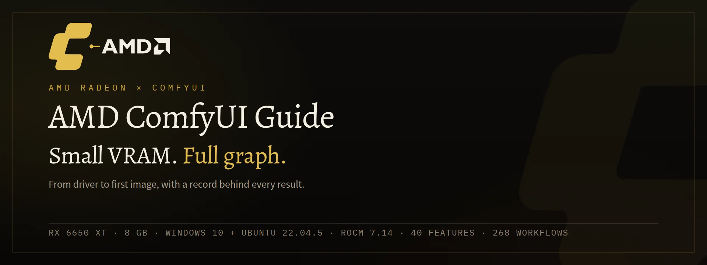
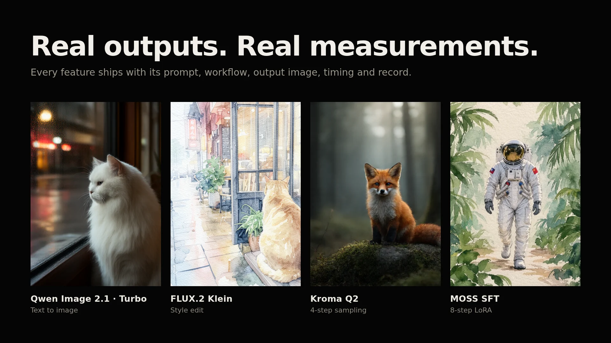

<div align="center">



# AMD ComfyUI Guide

**Small VRAM. Full graph.**

ComfyUI on AMD Radeon GPUs, from a bare driver to a first image, with a record
behind every result.

[English](README.md) · [简体中文](README.zh-CN.md)

[](https://github.com/AiKiAi-stack/amd-comfyui-guide/actions/workflows/check-publication.yml)
[](https://github.com/AiKiAi-stack/amd-comfyui-guide/releases)
[](LICENSE)

</div>

---

## What this is

You have an AMD Radeon card and you want ComfyUI running on it. This guide takes you
through the install on Windows 10 or Ubuntu 22.04.5, gets a first image out of the
card, and then tells you which of 40 ComfyUI features actually run on 8 GB of VRAM.
Every feature has its own record: input, prompt, workflow, output image, timing and a
verdict, failures included.

All of it comes from one machine: an AMD Radeon RX 6650 XT (gfx1032) with 8 GB of
VRAM and 16 GB of RAM, on Windows 10 and on Ubuntu 22.04.5 with ROCm 7.14, PyTorch
2.12.0 and ComfyUI `ce1e922`. Windows records and Linux records are filed separately,
because they are not the same test.

That card is where the evidence comes from, not who the guide is for. If yours is a
different AMD card, read the [support matrix](docs/tutorial/08-amd-matrix.md) first
and find the tier it falls into.

## Results

<!-- STATS:START -->
| Metric | Value |
|---|---:|
| Model families | 7 |
| Features documented | 40 |
| Platform records | 162 (95 Windows + 67 Linux) |
| Workflows | 268 UI + 268 API · 184 installed |
| Documented cases | 88 |
<!-- STATS:END -->



The [full report](https://aikiai-stack.github.io/amd-comfyui-guide/) has 40 cards,
each with the input, prompt, real output, timing and per-platform verdict.

## Quick start

1. **Compare your hardware.** The
   [hardware chapter](docs/tutorial/01-hardware.md) opens with the table to check
   against. On a card other than the RX 6650 XT, read the
   [support matrix](docs/tutorial/08-amd-matrix.md) before installing anything.
2. **Install.** [Windows](docs/tutorial/02-windows-setup.md) or
   [Ubuntu + ROCm](docs/tutorial/03-ubuntu-rocm.md). Ubuntu is the only path that
   was completed from a fresh, independent environment.
3. **Get one image out.** Follow [first image](docs/tutorial/04-first-image.md), then
   pick a workflow from the [workflow library](docs/tutorial/06-workflows.md).

No AMD card at hand? The [report](https://aikiai-stack.github.io/amd-comfyui-guide/)
needs no model weights.

## Workflow library

268 WebUI workflows, each with a matching API file, checked by importing and
exporting every one in the real ComfyUI frontend. Two bundles:

- [Full, about 360 MiB](https://github.com/AiKiAi-stack/amd-comfyui-guide/releases/download/model-feature-workflows-2026-10-26/model-feature-workflows.zip):
  workflows, input images and the checked encoding files.
- [Light, about 12 MiB](https://github.com/AiKiAi-stack/amd-comfyui-guide/releases/download/model-feature-workflows-2026-10-26/model-feature-workflows-light.zip):
  workflows only; run the encoding step yourself.

Install steps, file naming and the SHA caveats are in the
[workflow library chapter](docs/tutorial/06-workflows.md).

## Tutorial

Read the chapters in order. They assume the card is already in the machine and the
driver is installed.

| Chapter | When to read it |
|---|---|
| [01 Hardware and versions](docs/tutorial/01-hardware.md) | confirm the GPU, OS and version combination before installing |
| [02 Windows setup](docs/tutorial/02-windows-setup.md) | a native AMD environment on Windows |
| [03 Ubuntu + ROCm](docs/tutorial/03-ubuntu-rocm.md) | the verified path, from a fresh environment |
| [04 First image](docs/tutorial/04-first-image.md) | prove the GPU actually renders |
| [05 Models](docs/tutorial/05-models.md) | pick a model family and place the weights |
| [06 Workflow library](docs/tutorial/06-workflows.md) | download, import and reproduce a result |
| [07 Troubleshooting](docs/tutorial/07-troubleshooting.md) | init crashes, OOM, black or noisy images |
| [08 AMD support matrix](docs/tutorial/08-amd-matrix.md) | adapt the guide to another AMD card |

The full index is in [docs/](docs/README.md).

## Evidence and how to read it

Four things get recorded separately: the workflow opens, an image comes out, the
target is met, and the run is stable across repeats. They are not interchangeable.
Failed and partial results stay on the record on purpose, because they are usually
the part you need when your own card behaves the same way.

Start with [evidence and privacy](docs/reference/evidence-and-privacy.md) and the
[failure tracker](docs/reference/failure-tracker.md). The raw experimental trail that
the report does not reference is archived in
[barely-comfy-evidence](https://github.com/AiKiAi-stack/barely-comfy-evidence) with a
SHA-256 manifest.

## Project layout

```
docs/         tutorial, reference, journal
evidence/     per-feature report, cases and platform records
workflows/    268 UI + API workflows, catalog and bundles
scripts/      install, replay, verification
environment/  pinned versions and hardware records
assets/       README and site visuals, built from real outputs
```

## Related

- **[ming-tts-webui](https://github.com/AiKiAi-stack/ming-tts-webui)**: a local
  Ming-3.0-TTS speech workbench (Gradio + FastAPI on AMD ROCm), kept in its own
  repository.

## Contributing

The most useful contribution is a reproduction on another AMD card. Bring the input,
prompt, workflow, output, timing and the failure evidence. Read
[CONTRIBUTING.md](CONTRIBUTING.md) first.

## License

[MIT](LICENSE). Third-party sources and upstream licensing are listed in
[THIRD_PARTY_NOTICES.md](THIRD_PARTY_NOTICES.md).
