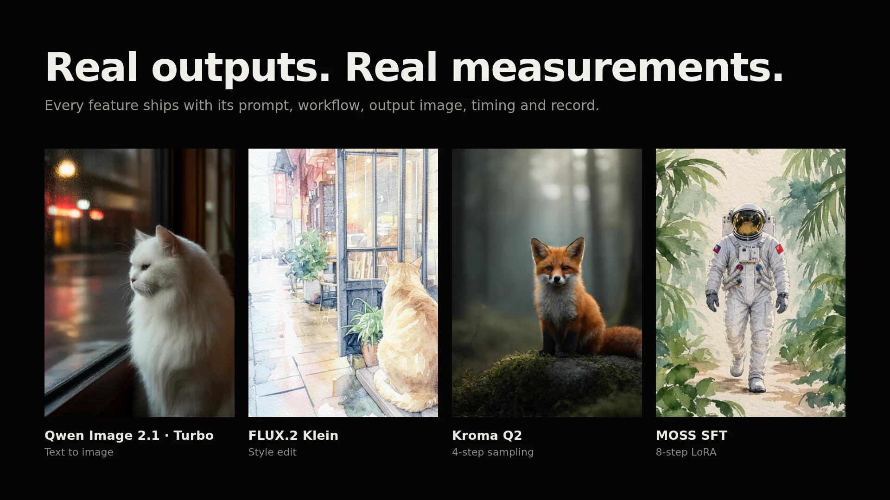

<div align="center">

<picture>
  <source media="(prefers-color-scheme: dark)" srcset="assets/brand/mark.svg">
  
</picture>

# AMD 显卡 ComfyUI 指南

**从驱动到第一张图。**

在 AMD 显卡上跑 ComfyUI：从装驱动到出第一张图，每个结果都能回到原始记录。

[English](README.md) · [简体中文](README.zh-CN.md)

[](https://github.com/AiKiAi-stack/amd-comfyui-guide/actions/workflows/check-publication.yml)
[](https://github.com/AiKiAi-stack/amd-comfyui-guide/releases)
[](LICENSE)

</div>

---

## 快速开始

1. **先确认能不能照做。** [01 章](docs/tutorial/01-hardware.md)只看三件事：架构代号、显存档位、系统和驱动。换一张 AMD 卡，先读[适配矩阵](docs/tutorial/08-amd-matrix.md)。
2. **装环境。** [Windows](docs/tutorial/02-windows-setup.md) 或 [Ubuntu + ROCm](docs/tutorial/03-ubuntu-rocm.md)。Ubuntu 是唯一从全新独立环境走完整套流程的路径。
3. **出一张图。** 跟着[第一张图](docs/tutorial/04-first-image.md)走一遍，然后从[工作流库](docs/tutorial/06-workflows.md)挑一份工作流。

## 教程

按顺序读。

| 章节 | 什么时候读 |
|---|---|
| [01 先确认能不能照做](docs/tutorial/01-hardware.md) | 判断你的卡适不适合照做 |
| [02 Windows 环境搭建](docs/tutorial/02-windows-setup.md) | 在 Windows 10/11 上安装 |
| [03 Ubuntu + ROCm](docs/tutorial/03-ubuntu-rocm.md) | 在 Ubuntu 上从全新环境安装 |
| [04 第一张图](docs/tutorial/04-first-image.md) | 验证 GPU 真的能出图 |
| [05 模型](docs/tutorial/05-models.md) | 挑一个模型系列，把权重放到位 |
| [06 工作流库](docs/tutorial/06-workflows.md) | 下载、导入、复现一项结果 |
| [07 排障](docs/tutorial/07-troubleshooting.md) | 初始化崩溃、OOM、黑图、噪声图 |
| [08 换一张 AMD 卡怎么套用](docs/tutorial/08-amd-matrix.md) | 实测卡以外的卡要改什么 |

完整文档索引在 [docs/](docs/README.md)。

## 工作流库

268 份 WebUI 工作流，每份配一个 API 文件，全部在真实的 ComfyUI 前端里导入导出核对过。两个包：

- [完整包，约 360 MiB](https://github.com/AiKiAi-stack/amd-comfyui-guide/releases/download/model-feature-workflows-2026-10-26/model-feature-workflows.zip)：工作流、输入图片，以及核对过的编码文件。
- [轻量包，约 12 MiB](https://github.com/AiKiAi-stack/amd-comfyui-guide/releases/download/model-feature-workflows-2026-10-26/model-feature-workflows-light.zip)：只有工作流，编码步骤自己跑。

安装步骤、文件命名和 SHA 注意事项在[工作流库](docs/tutorial/06-workflows.md)那一章。

## 实测结果

<!-- STATS:START -->
| 指标 | 数值 |
|---|---:|
| 模型系列 | 7 |
| 功能记录 | 40 |
| 平台记录 | 162（95 Windows + 67 Linux） |
| 工作流 | 268 UI + 268 API · 已安装 184 |
| 记录案例 | 88 |
<!-- STATS:END -->



[完整功能报告](https://aikiai-stack.github.io/amd-comfyui-guide/)有 40 张卡片，每张都带输入、提示词、真实输出、耗时和各平台结论。报告不需要模型权重，只想看看模型能出什么图也可以直接打开。

## 证据怎么读

所有数字来自同一台机器，配置、平台覆盖和固定版本记在[实测环境](docs/reference/test-machine.md)。那张卡是证据来源，不是读者范围：这是单机实测报告，不是 AMD 兼容性列表，换卡之前先看[适配矩阵](docs/tutorial/08-amd-matrix.md)。

四件事分开记录：工作流能打开、实际出图、达到目标、连续重复还稳定。四者不能互相顶替。失败和部分达到的结果刻意留在记录里。先看[证据结构与公开副本](docs/reference/evidence-and-privacy.md)和[故障追踪与根因边界](docs/reference/failure-tracker.md)。报告没有引用的原始实验归档在 [barely-comfy-evidence](https://github.com/AiKiAi-stack/barely-comfy-evidence)，附 SHA256 清单。

## 仓库结构

```
docs/         教程（tutorial）、参考（reference）、日志（journal）
evidence/     功能报告、case 与平台记录
workflows/    268 份 UI + API 工作流、catalog 与下载包
scripts/      安装、重放与校验脚本
environment/  固定版本与硬件记录
assets/       README 与站点视觉素材（由真实出图构建）
```

## 相关项目

- **[ming-tts-webui](https://github.com/AiKiAi-stack/ming-tts-webui)**：Ming-3.0-TTS 本地语音工作台（Gradio + FastAPI，AMD ROCm），单独一个仓库。

## 参与贡献

最有价值的贡献是在别的 AMD 卡上复现一遍。带上输入、提示词、工作流、输出、耗时和失败证据。动手之前先看 [CONTRIBUTING.md](CONTRIBUTING.md)。

## 许可证

[MIT](LICENSE)。第三方来源和上游授权见 [THIRD_PARTY_NOTICES.md](THIRD_PARTY_NOTICES.md)。
