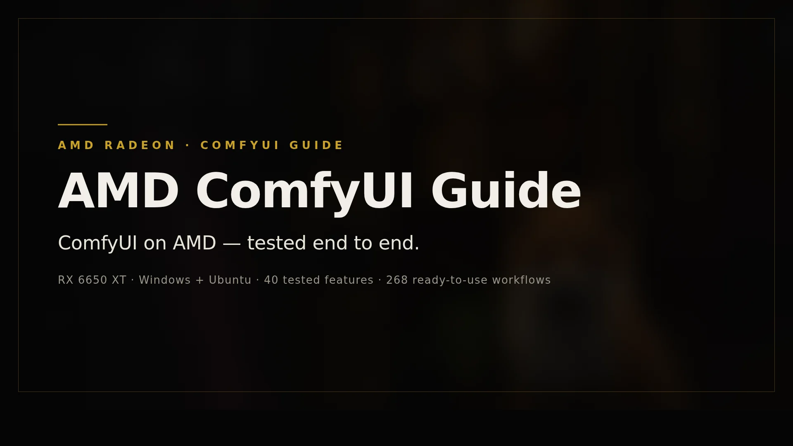
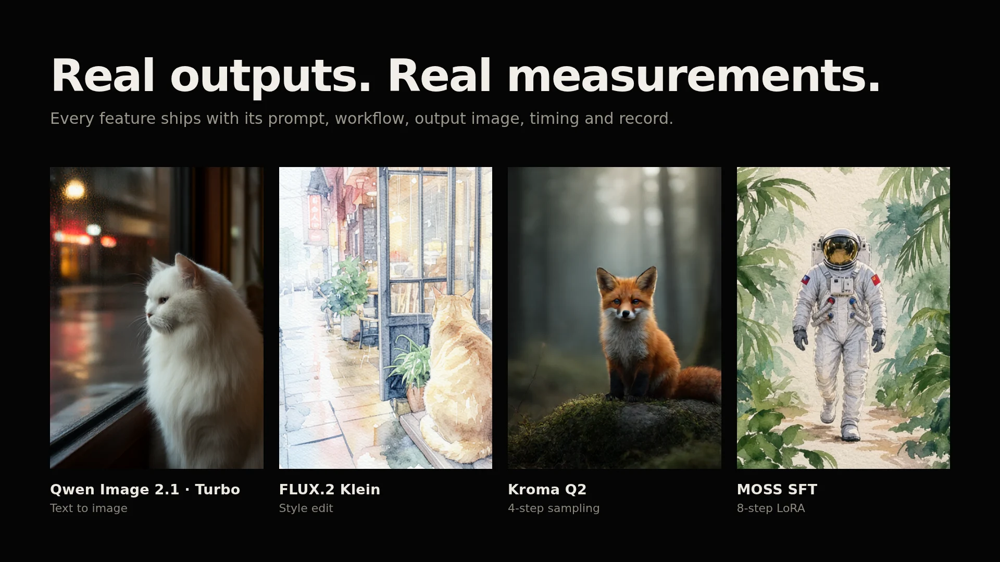

<div align="center">



# AMD 显卡 ComfyUI 指南

**在 AMD 显卡上跑 ComfyUI：每一步实测，每个结果可查。**

Windows 与 Ubuntu 的分步部署教程、逐项实测的功能清单、可直接使用的工作流库，
全部在一张 RX 6650 XT（8GB）上记录。

[English](README.md) · [简体中文](README.zh-CN.md)

[](https://github.com/AiKiAi-stack/amd-comfyui-guide/actions/workflows/check-publication.yml)
[](https://github.com/AiKiAi-stack/amd-comfyui-guide/releases)
[](LICENSE)

</div>

---

## 这是什么

一份面向 AMD 显卡的 ComfyUI 部署指南，附带可复核的实测证据。它从一台已验证的机器开始——RX 6650 XT、8GB 显存、Windows 10 与 Ubuntu 22.04.5 + ROCm 7.14——逐步记录 7 个模型系列、40 项功能：哪些通过、哪些部分达到、哪些失败以及原因。

- **已验证硬件：** AMD Radeon RX 6650 XT（gfx1032）· 16GB 内存
- **已验证环境：** Ubuntu 22.04.5 · ROCm 7.14 · PyTorch 2.12.0 · ComfyUI `ce1e922`
- **适合读者：** 想知道某个 ComfyUI 功能在自己的 AMD 卡上能不能跑、怎么跑的人

这是**单机实测报告，不是 AMD 兼容性列表**。其他显卡请看 [AMD 显卡适配矩阵](docs/tutorial/08-amd-matrix.md)。

## 实测结果

<!-- STATS:START -->
| 指标 | 数值 |
|---|---:|
| 模型系列 | 7 |
| 实测功能 | 40 |
| Linux 结论 | 21 通过 · 18 部分达到 · 1 未达到 |
| 平台记录 | 162（95 Windows + 67 Linux） |
| 工作流 | 268 UI + 268 API · 已安装 184 |
| 记录案例 | 88 |
<!-- STATS:END -->



打开 **[完整功能报告](https://aikiai-stack.github.io/amd-comfyui-guide/)**：40 张卡片，每项都带输入、提示词、真实出图、耗时与各平台结论。

## 快速开始

1. **确认硬件** —— [硬件、系统与版本](docs/tutorial/01-hardware.md)。不是 RX 6650 XT？先读 [适配矩阵](docs/tutorial/08-amd-matrix.md)。
2. **安装环境** —— [Windows](docs/tutorial/02-windows-setup.md) 或 [Ubuntu + ROCm](docs/tutorial/03-ubuntu-rocm.md)。Ubuntu 是唯一从全新独立环境完成全链路验证的路径。
3. **生成第一张图** —— [第一张图](docs/tutorial/04-first-image.md)，然后从[工作流库](docs/tutorial/06-workflows.md)挑一份工作流开始。

没有显卡也能看：[功能报告](https://aikiai-stack.github.io/amd-comfyui-guide/)不需要模型权重。

## 下载工作流库

268 份 WebUI 工作流及对应 API，全部经过真实前端导入/导出回环核对：

- **[完整包（约 360 MiB）](https://github.com/AiKiAi-stack/amd-comfyui-guide/releases/download/model-feature-workflows-2026-10-26/model-feature-workflows.zip)**：含输入图片与经过校验的编码结果
- **[轻量包（约 12 MiB）](https://github.com/AiKiAi-stack/amd-comfyui-guide/releases/download/model-feature-workflows-2026-10-26/model-feature-workflows-light.zip)**：只有工作流，需先运行编码步骤

安装步骤、命名规则与 SHA 注意事项见 [工作流库](docs/tutorial/06-workflows.md)。

## 教程

| 章节 | 什么时候读 |
|---|---|
| [01 硬件、系统与版本](docs/tutorial/01-hardware.md) | 先确认你的显卡 / 系统 / 版本组合 |
| [02 Windows 环境搭建](docs/tutorial/02-windows-setup.md) | 在 Windows 上使用原生 AMD 环境 |
| [03 Ubuntu + ROCm](docs/tutorial/03-ubuntu-rocm.md) | 已验证路径，从全新环境开始 |
| [04 第一张图](docs/tutorial/04-first-image.md) | 验证 GPU 是否真的能出图 |
| [05 模型选择](docs/tutorial/05-models.md) | 下载与放置模型权重 |
| [06 工作流库](docs/tutorial/06-workflows.md) | 下载、导入并复现结果 |
| [07 排障](docs/tutorial/07-troubleshooting.md) | 初始化崩溃、OOM、黑图与噪声图 |
| [08 AMD 卡适配矩阵](docs/tutorial/08-amd-matrix.md) | 把本指南套用到其他 AMD 卡 |

完整文档索引：[docs/](docs/README.md)。

## 证据怎么读

每项功能都有独立 case：提示词、工作流、输出图片、耗时与结论。"工作流能打开""实际出图""达到目标""连续稳定"是四件事，分开记录、互不替代；失败与部分达到的结果也刻意保留。见[证据结构与公开副本](docs/reference/evidence-and-privacy.md)与[故障追踪](docs/reference/failure-tracker.md)。

## 仓库结构

```
docs/         教程（tutorial）、参考（reference）、日志（journal）
evidence/     功能报告、case 与平台记录
workflows/    268 份 UI + API 工作流、catalog 与下载包
scripts/      安装、重放与校验脚本
environment/  固定版本与硬件记录
assets/       README 与站点视觉素材（由真实出图构建）
```

## 相关项目

- **[ming-tts-webui](https://github.com/AiKiAi-stack/ming-tts-webui)**：同机另做的 Ming-3.0-TTS 本地语音工作台（Gradio + FastAPI，AMD ROCm），已拆为独立仓库。

## 参与贡献

最有价值的贡献是在其他 AMD 卡上复现——请带上输入、提示词、工作流、输出、耗时与失败证据。见 [CONTRIBUTING.md](CONTRIBUTING.md)。

## 许可证

[MIT](LICENSE)。第三方来源与上游授权见 [THIRD_PARTY_NOTICES.md](THIRD_PARTY_NOTICES.md)。
