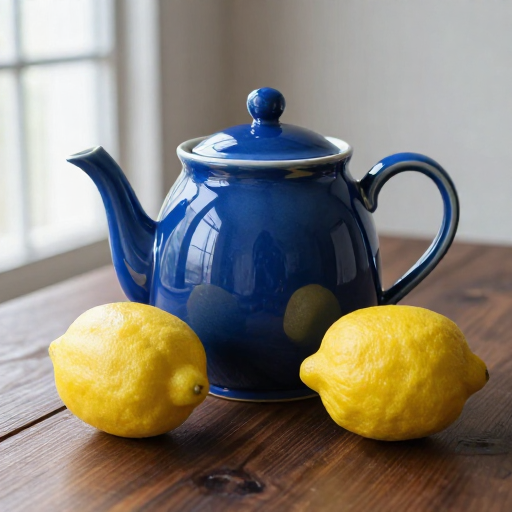
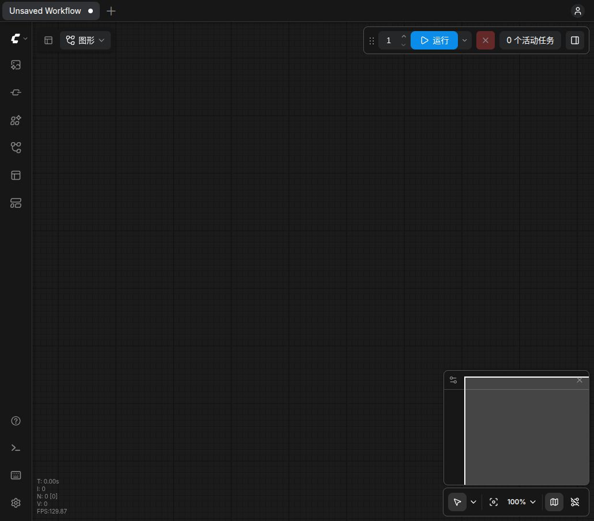

# Ubuntu 续接实验 · 2026-10-24

环境、固定版本、存储布局和复跑命令见 [续接日记](../../docs/journal/2026-10-24-ubuntu-continuation.md)。本目录追加 Linux 证据，不改 Windows 历史结论。

- [SSD 环境版本核对](ssd-environment.json)、[GPU 检查](ssd-gpu-check.json)：95 个依赖版本一致；Torch 导入约 2.123 秒，小 GPU 运算通过。
- [7 个已有模型 SHA](nvme-model-hashes.json)：复用只读挂载的 NVMe 权重，无重新下载。
- [报告补卡证明](report-repair.json)、[待办审计](backlog-audit.json)：101 张卡片齐全，原 100 张 article 字节不变；原“部分达到”未改。
- [有效 fixture 的原 GGUF 失败](cpu-detach-stock.txt)、[候选通过](cpu-detach-candidate.txt)、[Linux runtime 通过](cpu-detach-runtime.txt)。早期 ≤1MiB fixture 的 StopIteration 不作为行为失败证据。
- [Linux runtime 补丁和 SHA](cpu-detach-runtime-patch.json)：原 `nodes.py` 字节备份为同名 `.original.py`；没有修改 Windows 节点，不处理 unpatch/OOM。
- [未改 GGUF 的 SSD/NVMe 基线](qwen-stock-nvme-result.json)：编码器加载期间 HTTP60秒超时，没有图片，无 native/OOM 证据。
- [CPU detach 后默认精度结果](qwen-default-cast-guard-result.json)：编码器加载完成，扩散加载阶段触发物理内存保护，未出图。
- [10月23日 no-pin 结果补记](qwen-20261023-no-pin-result-supplement.json)：没有完成加载，旧 raw summary 的 running 已失效。
- [本轮回归测试](regression-tests.json)：保留命令名称、退出码和完整测试输出。

## `/free` 的严格阈值与分配器缓存

`runs/ubuntu-20261024-qwen-phases-fp16-01` 编码成功后，真实 `/free` 未在30秒内达到 reserved ≤256MiB；新的 `qwen-free-trace-01` 增加60秒采样和线程栈，确认工作线程已回到队列等待。记录区分 `torch_vram_total`（reserved）与 `torch_vram_total - torch_vram_free`（active，来自核心 memory_stats 的 active_bytes）。实际 active 降至约32MiB，reserved 仍约1.16GiB。严格 reserved 条件仍记失败，没有把它改写为通过。

后续运行器新增显式 `--free-check active`：要求 active ≤256MiB，并完整保留 reserved/active 两种指标和每次真实 `/free` 响应。这允许分配器缓存继续存在，只验收模型执行、有效占用释放和同进程重载，不声称 reserved 全释放或异常/OOM 恢复。物理内存阈值仍为1536MiB。两轮完整结果和图片目视记录在执行后追加。

## 第一张完整 Qwen 和主机堆回收对照

`qwen-phases-active-01` 被 GDB 抓栈的额外主机内存和暂停干扰，触发 RAM 保护；不能用于判断模型容量/性能，见 [干扰补记](qwen-active-01-confound.json)。随后不运行 GDB 的 `qwen-phases-active-02` 完成第一轮：编码49.02秒、15步采样319.11秒、CPU解码16.01秒，各阶段真实 `/free` 后 active 均低于256MiB，但 reserved 未全部降至阈值。第二轮编码触发1536MiB物理RAM保护，因此**同进程两轮仍未通过**。[原始摘要副本](qwen-first-complete-run-summary.json)。

第一张512²完整PNG图像健康通过，骷髅幽灵、长剑、雾气、红月可见；眼部蓝光较弱、破碎彩窗细节不足，提示细节评价为“部分达到”。[图片和实际API/history绑定](qwen-first-complete/result.json)、[独立目视](review-qwen-first.json)。公开PNG去除metadata，逐像素校验与原图一致。

对相同保存latent的CPU解码做独立小探针；这次没有新采样。实际 `/free` 后，显式 GC + glibc `malloc_trim(0)` 使进程RSS最终降至约1.1GB，其中 malloc_trim 调用区间释放1,089,417,216字节，锁页登记为0。[探针摘要](cpu-heap-probe-summary.json)、[回收测量](cpu-heap-probe-trim.json)。这证明该探针存在可回收的主机堆，不证明所有残留都来自glibc，也不替代完整重载。

运行器增加显式 `--host-trim --stack-hook trials/2026-10-24-ubuntu/diagnostics` 对照，只有实验子进程启用：在阶段 `/free` 后、空闲时回收未使用堆，并保留前后RSS、RAM和锁页字节。无Torch/系统库替换，无默认启动参数变化。完整两轮对照按实际结果追加。

该完整两轮对照仍失败：[摘要](qwen-host-trim-result.json)、[回收量](qwen-host-trim-measurements.json)。第二轮编码完成，但随后 `/free` 峰值触发物理RAM保护，最后观测可用内存约297MiB；服务由保护停止，退出0。因此 `malloc_trim` **不是连续重载修复**，也没有改成默认行为。第一张与前一次无trim图不逐像素相同，平均通道绝对差约0.084/255；两图健康正常，但差异原因没有隔离，见 [测量](first-image-trim-comparison.json)。

固定核心源码另确认：没有参考图时，`TextEncodeQwenImage21` 完全不读取可选VAE。运行器新增显式 `--omit-unused-vae`，仅当节点输入全部属于已知的纯文本字段时移除编码阶段的VAE依赖，解码阶段照常加载；任何参考图或未知字段均保留依赖。[两项实际核心契约测试](qwen-no-reference-vae-tests.txt)通过，条件与初始latent严格一致，带参考图的保护也通过。加上原32项，本轮34项回归通过；实际整模型RAM效果另行实测，不凭契约测试宣布重载修复。

## 独立进程的第二张完整图

新进程运行第二份原15步工作流，编码52.06秒、采样316.13秒、CPU解码13.01秒，三次真实 `/free` 后 active 均达到阈值，服务正常退出0；没有启用堆回收或省略VAE。[摘要](qwen-green-isolated-summary.json)、[图片及绑定](qwen-green-isolated/result.json)、[目视评价](review-qwen-green.json)。这是每图一个进程的可用规避，不能和前一张合并成同进程通过。

图像健康通过，眼部/头骨有绿色调，强烈绿光等精确细节仍记部分达到。与旧Windows功能评价分开，不改变原19条或49条待办。

## 最后一组：省略未使用 VAE 的实际边界

在失败的host-trim配置上只增加 `--omit-unused-vae`，仍使用原512²、15步工作流和1536MiB保护。首轮编码47.59秒完成，随后 `/free` 期间RAM保护触发，没有采样或新PNG。最后观测可用物理内存970,481,664字节。[实际结果](qwen-no-unused-vae-result.json)含启动时运行器、核心Qwen节点及GGUF源码SHA。

因此省略无用VAE仅保留为经过契约验证的可选图优化，**没有证明解决连续重载或卸载峰值**，默认不启用。堆回收和它都不推广成修复；当前可靠完成记录仍是第一张完整蓝图及独立进程绿图。所有完整采样均为15步，没有用低步数诊断冒充完整视觉验收。准备过但未执行的1步诊断图已清理。

## Z-Image 回归及最终服务

在已应用CPU detach的Linux副本、SSD环境和NVMe模型上，同进程连续红/蓝茶壶 **2/2执行成功、2/2目视通过**。512²、9步、CFG1、Euler/simple，默认attention和锁页参数、GPU文本、CPU VAE、关闭动态显存/异步卸载；未启用堆回收、CPU backing或省略VAE。文本节点8和采样节点10每轮确实重新执行，变化的提示和seed有API/history绑定。[执行与公开图](zimage-repeat/summary.json)、[独立目视](zimage-reviews.json)、[内存摘要](zimage-memory-summary.json)。

两轮提交至history约188.56/168.51秒；没有做严格冷热、kernel及存储单变量控制，不声明性能提速。768MiB保护未触发。公开PNG去metadata且与原图逐像素相同；源码commit是导出基线，实际GGUF另有明确补丁SHA，不能把当前结果当作stock源码。

测试自有服务已停止。默认8188界面随后启动，HTML、GPU状态和9个所需节点接口均通过，浏览器已显示主画布、0个活动任务。[服务检查](service-liveness.json)、[本轮结果索引](outcomes.json)。使用 `bash scripts/start_ubuntu.sh` 启动；该默认入口不启用实验堆回收/省略VAE。当前运行进程信息和日志在 `runtime/ubuntu/service-20261024.*`。

界面 <http://127.0.0.1:8188/>；报告 <http://127.0.0.1:8767/trials/2026-10-19-features/feature-report.html>，均仅监听本机。重启后GPU临时ACL和只读NVMe挂载需要重新核对，服务本身未配置开机自启。没有提交、推送或对外发布。

## Ubuntu 报告显示

[追加图库的50个历史案例和SHA](report-path-gallery.json)修复旧Windows绝对路径在Linux显示为空的问题；全部101张既有article字节保持一致，239个HTML图片链接均存在。浏览器已核对实际显示；原卡片及旧评价不变。更多保存检查见 [保留证明](preservation-check.json)。

