# ComfyUI 模型功能图像对照

设备：RX 6650 XT（8 GB 显存）与 16 GB RAM。本轮 512 × 512；旧基线可为 768 × 768，以记录为准。

来源边界：Z-Image 两篇用户提供的离线正文已核验，Flux.2 Klein 正文此前已正常读取；其他未读文章仍只依据可用索引、作者站外材料与上游证据。来源级别见每张卡片。

精确节点参数见各卡片的 workflow / api.json。API 执行成功只说明工作流成功返回；功能视觉成功以视觉结论为准。

生成于：2026-10-21 21:32 中国标准时间

## 图生图／洗图（`moss-img2img`）

- 模型：MOSS-Image-5B
- 来源级别：公众号索引标题
- 执行：API 执行成功 · 无可用输出图片；耗时：245.85 秒
- 视觉结论：部分达到

API 完成并保持了宇航员与丛林构图，细节有变化；但去噪 0.6 下未出现明显水彩纸张和笔触，不能记为风格转换成功。

输入图片：
- 输入 1 · astronaut：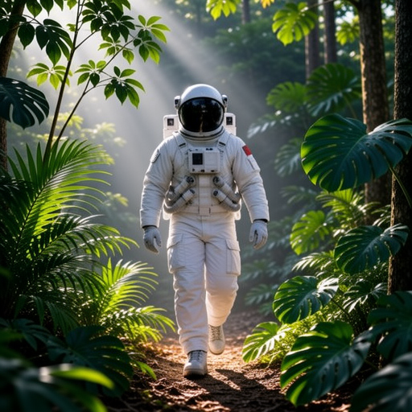

输出图片：
- 无输出

<details>
<summary>Prompt、预期结果与 workflow</summary>

Prompt:

```text
A watercolor illustration of the same astronaut walking through a lush jungle, soft watercolor washes, visible paper texture, green foliage and warm sunlight. Preserve the centered full-body composition.
```

预期结果：宇航员丛林构图保留，风格变为水彩；这是 VAE latent 图生图，不代表原生参考图语义编辑。

workflow / api.json：[moss-img2img/api.json](cases/moss-img2img/api.json)

</details>

---

## 布局描述（JSON 提示）（`moss-layout`）

- 模型：MOSS-Image-5B
- 来源级别：上游布局提示拓展测试，非已确认文章声明
- 执行：API 执行成功 · 无可用输出图片；耗时：185.56 秒
- 视觉结论：达到本例目标

肉眼检查可见独立红茶壶在左、蓝花瓶在右，位置与指定区域大致相符；未量化像素坐标误差，也未做去掉 bbox 的对照，不能据此单独归因于 bbox 控制。

输入图片：
- 此功能没有输入图片。

输出图片：
- 无输出

<details>
<summary>Prompt、预期结果与 workflow</summary>

Prompt:

```text
{"summary":{"caption":"A clean studio product photograph on a pale grey table. A bright red teapot on the left and a tall blue ceramic vase on the right, clearly separated."},"items":[{"label":"object","caption":"one bright red teapot with a handle and spout, on the left","bbox":[-96,-226,184,-16]},{"label":"object","caption":"one tall blue ceramic vase, on the right","bbox":[-116,44,184,214]}],"bbox_coord_space":"abs_centralized","bbox_format":"yxyx"}
```

预期结果：红茶壶在左、蓝花瓶在右，各自落在指定区域。

workflow / api.json：[moss-layout/api.json](cases/moss-layout/api.json)

</details>

---

## 画面文字渲染（`moss-text`）

- 模型：MOSS-Image-5B
- 来源级别：上游布局文字功能，非已确认文章声明
- 执行：API 执行成功 · 无可用输出图片；耗时：221.37 秒
- 视觉结论：达到本例目标

肉眼可读的 HELLO 拼写准确，下方是一个橙子，未见多余文字；此结论限这张简单英文海报，不代表复杂中文排版也通过。

输入图片：
- 此功能没有输入图片。

输出图片：
- 无输出

<details>
<summary>Prompt、预期结果与 workflow</summary>

Prompt:

```text
A minimalist poster on plain cream paper. The single word HELLO is printed in huge bold clean black capital letters across the upper half. A single small orange fruit below the word. Exact text: HELLO. No other text.
```

预期结果：图片中准确出现可读的 HELLO，且没有其他文字。

workflow / api.json：[moss-text/api.json](cases/moss-text/api.json)

</details>

---

## 文生图素材：虚构人像 A（`kroma-portrait-a`）

- 模型：Kroma v0.3.1 OPD Q2
- 来源级别：测试素材
- 执行：API 执行成功 · 无可用输出图片；耗时：200.32 秒
- 视觉结论：素材可用

虚构成年女性人像清晰，短卷铜红发、浅肤色、雀斑、绿眼和黄毛衣均可辨，足以作为后续身份参考。

输入图片：
- 此功能没有输入图片。

输出图片：
- 无输出

<details>
<summary>Prompt、预期结果与 workflow</summary>

Prompt:

```text
Studio head-and-shoulders portrait photograph of a fictional adult woman aged 30, pale skin, distinct freckles across nose and cheeks, green eyes, short curly copper-red hair, mustard yellow sweater, plain light grey background, looking directly at camera, sharp face, natural light.
```

预期结果：清晰的虚构红发雀斑成年女性人像，供换脸与身份参考试验。

workflow / api.json：[kroma-portrait-a/api.json](cases/kroma-portrait-a/api.json)

</details>

---

## 文生图素材：虚构人像 B（`kroma-portrait-b`）

- 模型：Kroma v0.3.1 OPD Q2
- 来源级别：测试素材
- 执行：API 执行成功 · 无可用输出图片；耗时：175.33 秒
- 视觉结论：素材可用

独立进程重试后出图。黑直发、深蓝大衣、红围巾、公园背景与侧转头姿势清楚，与 A 外观明显不同。首轮连续任务的 native crash 保留在 attempts 目录。

输入图片：
- 此功能没有输入图片。

输出图片：
- 无输出

<details>
<summary>Prompt、预期结果与 workflow</summary>

Prompt:

```text
Waist-up portrait photograph of a different fictional adult woman aged 35 with dark straight shoulder-length hair, brown eyes, medium brown skin, wearing a navy blue coat and red scarf, standing outdoors in a park, turned slightly to the left, calm smile, soft daylight.
```

预期结果：与 A 明显不同的虚构人物，供保留服装姿态的换脸试验。

workflow / api.json：[kroma-portrait-b/api.json](cases/kroma-portrait-b/api.json)

</details>

---

## 图生图／洗图（`kroma-img2img`）

- 模型：Kroma v0.3.1 OPD Q2
- 来源级别：公众号索引标题
- 执行：API 执行成功 · 无可用输出图片；耗时：250.94 秒
- 视觉结论：达到风格目标，姿态有变化

输出出现明确水彩晕染与纸张笔触，雨街、左侧霓虹和右侧橘猫关系保留；猫由背对转成朝向镜头，街景细节也被重绘，不算严格保持原图。

输入图片：
- 输入 1 · cat：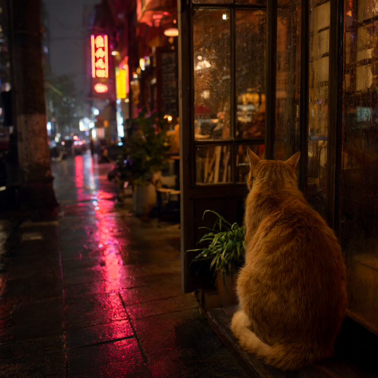

输出图片：
- 无输出

<details>
<summary>Prompt、预期结果与 workflow</summary>

Prompt:

```text
Watercolor illustration of an orange cat sitting by a cafe doorway on a rainy neon-lit Shanghai street. Preserve the composition, soft translucent watercolor, textured paper.
```

预期结果：雨街猫咪构图保留，转成水彩风格；不是语义参考编辑。

workflow / api.json：[kroma-img2img/api.json](cases/kroma-img2img/api.json)

</details>

---

## 文生图素材：风格参考（`kroma-style-source`）

- 模型：Kroma v0.3.1 OPD Q2
- 来源级别：测试素材
- 执行：API 执行成功 · 无可用输出图片；耗时：210.23 秒
- 视觉结论：素材可用

有清晰狐狸主体、蓝橙主色、平面几何森林与纸张版画纹理，可作风格参考；实际还有浅蓝和米白，未严格限制为两种墨色。

输入图片：
- 此功能没有输入图片。

输出图片：
- 无输出

<details>
<summary>Prompt、预期结果与 workflow</summary>

Prompt:

```text
A red fox in a forest, flat two-color screenprint poster, bold geometric shapes, dark blue and orange ink only, rough paper print texture, minimalist illustration, no gradients, no text.
```

预期结果：明确的蓝橙双色版画风格参考。

workflow / api.json：[kroma-style-source/api.json](cases/kroma-style-source/api.json)

</details>

---

## 遮罩局部重绘（`qwen-inpaint`）

- 模型：Qwen-Image-2.1
- 来源级别：公众号索引标题
- 执行：批次崩溃后恢复图片（非全批成功）；耗时：整个批次 322.69 秒（非单项耗时）
- 视觉结论：部分达到，物种替换不确定

遮罩像素核验：
- 遮罩外改变像素 / 总像素：0 / 193,144
- 遮罩内改变像素 / 总像素：66,431 / 69,000
- 遮罩外像素保留由最终合成节点实现，不归因于模型本身。

遮罩内主体变成偏红橙色，耳尖较尖，尾部出现明显浅色尾尖，带有狐狸特征；但主体仍是背影，体形和坐姿也仍像猫，无法仅凭此图确认已稳定完成猫到狐的替换。雨夜街景在最终合成图中保持一致。output-audit 显示遮罩外 193,144 像素中 0 像素变化、最大通道差为 0；这是最终合成节点的像素保留结果，不归因于模型。遮罩内 69,000 像素中 66,431 像素发生变化。该图从崩溃批次恢复，API 状态为 partial_output，不能记为整批 success。

输入图片：
- 输入 1 · cat：

输出图片：
- 无输出

<details>
<summary>Prompt、预期结果与 workflow</summary>

Prompt:

```text
Replace only the orange cat with a small red fox sitting in the same location facing away from the camera. Keep the rainy Shanghai cafe street and all other areas unchanged. Photorealistic.
```

预期结果：遮罩区域内猫变狐；遮罩外像素由工作流合成保留。

workflow / api.json：[qwen-inpaint/api.json](cases/qwen-inpaint/api.json)

</details>

---

## 多图参考／主体合成（`qwen-multiref`）

- 模型：Qwen-Image-2.1
- 来源级别：公众号索引标题；提示词不点名第二图主体，减少仅靠文字猜中任务的可能
- 执行：API 执行成功 · 无可用输出图片；耗时：325.4 秒
- 视觉结论：部分达到，狐狸主体明确
- 运行配置：512像素，GPU扩散、CPU VAE，15步。 本次重试通过核心 QwenImage21Cache(device=off) 关闭 prefix KV 缓存，绕开已观察的 GGUF cache.put 原生访问冲突；每步重算参考前缀。

提示词没有点名狐狸；输出清楚呈现红橙毛色、浅色胸口、黑色腿部和狐狸面部特征，并将背向镜头的猫换成同一位置附近、朝向镜头的狐狸。雨街霓虹、咖啡窗与湿地倒影仍可辨，但场景细节被重新绘制，不是像素级背景保留。该单例说明本次结果同时贴合第一图场景与第二图狐狸外观；没有消融对照，不能证明两张参考图均为必要条件，也不能据此声称精确保留了第二图身份。

输入图片：
- 输入 1 · cat：
- 输入 2 · fox：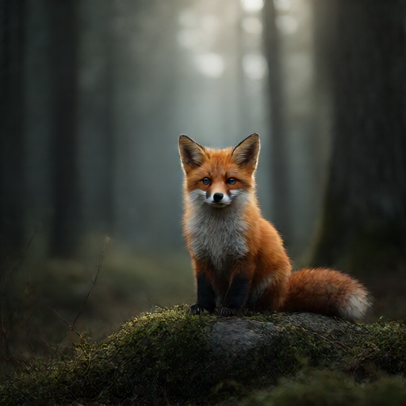

输出图片：
- 无输出

<details>
<summary>Prompt、预期结果与 workflow</summary>

Prompt:

```text
Use image 1 as the background and composition. Remove the existing animal in image 1 and place the animal subject from image 2 at the same location. Take its species, shape, fur colors and identifying features from image 2. Preserve the background, lighting, framing and perspective of image 1. Do not copy the background of image 2. Photorealistic.
```

预期结果：同时采用第一图雨街背景和第二图狐狸主体。

workflow / api.json：[qwen-multiref/api.json](cases/qwen-multiref/api.json)

</details>

---

## 换头／人物身份参考（`qwen-face-swap`）

- 模型：Qwen-Image-2.1
- 来源级别：公众号索引标题
- 执行：API 执行成功 · 无可用输出图片；耗时：整个批次 745.75 秒（非单项耗时）
- 视觉结论：部分达到，身份特征转移清楚
- 运行配置：512像素，GPU扩散、CPU VAE，15步。 本次重试通过核心 QwenImage21Cache(device=off) 关闭 prefix KV 缓存，绕开已观察的 GGUF cache.put 原生访问冲突；每步重算参考前缀。

输出呈现 A 的铜红卷发、浅肤色与绿眼，脸部外观向 A 靠近；B 的藏蓝大衣、红围巾、公园背景和单人构图保留。相比 B 原有的三分之四侧脸，输出更接近正面，头部角度发生变化；雀斑较淡。外观特征转移清楚，但不据此认定精确身份复现。

输入图片：
- 输入 1 · kroma-portrait-b：
- 输入 2 · kroma-portrait-a：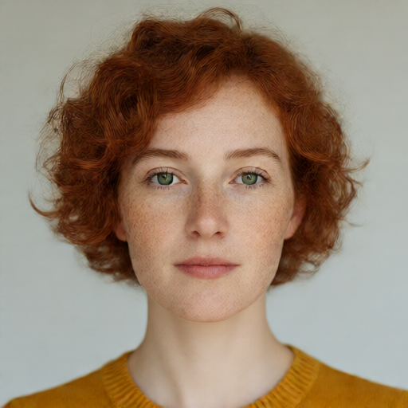

输出图片：
- 无输出

<details>
<summary>Prompt、预期结果与 workflow</summary>

Prompt:

```text
Edit image 1: replace the person's facial identity and hair with the fictional adult woman from image 2, including her copper-red curly hair, pale freckled skin and green eyes. Preserve the navy blue coat, red scarf, body pose, framing and outdoor park from image 1. Match lighting and proportions. Only one person.
```

预期结果：B 的服装、姿态与公园保留；身份特征改成 A 的红发、雀斑、绿眼。

workflow / api.json：[qwen-face-swap/api.json](cases/qwen-face-swap/api.json)

</details>

---

## 图生图／风格转换（`qwen-style-edit`）

- 模型：Qwen-Image-2.1
- 来源级别：公众号索引标题图生图；风格转换为具体测试任务
- 执行：API 执行成功 · 无可用输出图片；耗时：整个批次 745.75 秒（非单项耗时）
- 视觉结论：达到水彩风格目标
- 运行配置：512像素，GPU扩散、CPU VAE，15步。 本次重试通过核心 QwenImage21Cache(device=off) 关闭 prefix KV 缓存，绕开已观察的 GGUF cache.put 原生访问冲突；每步重算参考前缀。

纸面纹理、柔和晕染和水彩边缘非常明显。橘猫背影、咖啡窗、雨街霓虹与湿地倒影的主体关系基本保留；窗格、植物和光色细节有重绘，不是像素级保留。

输入图片：
- 输入 1 · cat：

输出图片：
- 无输出

<details>
<summary>Prompt、预期结果与 workflow</summary>

Prompt:

```text
Transform this photograph into a delicate watercolor painting. Keep the orange cat, its pose, the cafe entrance, the rainy street and the original framing. Use visible textured paper and soft watercolor washes. No text.
```

预期结果：主体与构图保留，风格明显变为水彩。

workflow / api.json：[qwen-style-edit/api.json](cases/qwen-style-edit/api.json)

</details>

---

## 自动反推提示词并再生成（`qwen-caption`）

- 模型：Qwen-Image-2.1
- 来源级别：同作者较早 Qwen 站外记录提到自动提示词，非当前公众号原文确认；本轮以核心 TextGenerate 作额外工作流测试
- 执行：失败（error）；耗时：146.02 秒
- 视觉结论：失败：未生成提示词或图片
- 运行配置：512像素，GPU扩散、CPU VAE，15步。 本次重试通过核心 QwenImage21Cache(device=off) 关闭 prefix KV 缓存，绕开已观察的 GGUF cache.put 原生访问冲突；每步重算参考前缀。 首轮TextGenerate触发HIPBLAS INT8错误；重试进程开启COMFY_GFX1032_INT8_FALLBACK=1，按层反量化后浮点计算。

首轮 TextGenerate 在 RX 6650 XT 上触发 HIPBLAS INT8 错误；开启 gfx1032 浮点反量化 fallback 后仍在 TextGenerate 报显存不足。此次恢复已核对 result.json 与日志；无 token、无图片，不计功能成功。

输入图片：
- 输入 1 · cat：

输出图片：
- 无输出

<details>
<summary>Prompt、预期结果与 workflow</summary>

Prompt:

```text
自动反推的实际提示词：

```

预期结果：先输出与输入猫咪雨街相符的提示词，再用该文字独立生成图片。

workflow / api.json：[qwen-caption/api.json](cases/qwen-caption/api.json)

</details>

---

## 风格参考（`kroma-style-ref`）

- 模型：Kroma v0.3.1 OPD Q2
- 来源级别：上游 Krea2 官方参考路径；当前仅Kroma Q2无专用style LoRA
- 执行：API 执行成功 · 无可用输出图片；耗时：整个批次 395.62 秒（非单项耗时）
- 视觉结论：未达到目标

蓝橙版画风格保留，但要求的新主体是猫头鹰，实际仍复制了参考狐狸与森林构图。当前无专用风格 LoRA 的 Q2 参考方案没有完成‘只取风格、换新主体’。原 1024 参考批次无图，此图来自 512 参考重试。

输出 512×512；参考 VAE 编码 512×512，视觉编码约 384×384；当前 Q2 未加载专用风格或 BFS LoRA。 原始 1024 参考批次反复 softmax 显存不足，随后 Fatal Python error: Aborted，无图片。保留该次证据后，使用核心 ReferenceLatent 节点改为 512 参考重试。

输入图片：
- 输入 1 · kroma-style-source：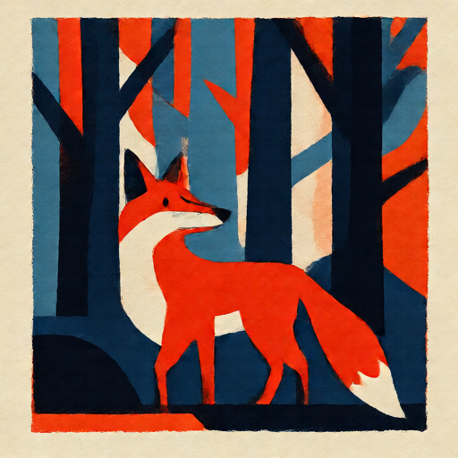

输出图片：
- 无输出

<details>
<summary>Prompt、预期结果与 workflow</summary>

Prompt:

```text
Use the visual style of the reference image: bold geometric two-color blue and orange screenprint, rough paper texture. Create a new image of an owl perched on a branch. Preserve the reference print style, not its fox subject. No text.
```

预期结果：参考图的蓝橙双色版画风格迁移到新主体猫头鹰。

workflow / api.json：[kroma-style-ref/api.json](cases/kroma-style-ref/api.json)

</details>

---

## 多图参考（`kroma-multiref`）

- 模型：Kroma v0.3.1 OPD Q2
- 来源级别：公众号索引标题；沿用上游Krea2接法探索
- 执行：API 执行成功 · 无可用输出图片；耗时：整个批次 395.62 秒（非单项耗时）
- 视觉结论：部分达到

可见雨街／霓虹背景与狐狸主体的结合，原猫被替换；但背景重画明显，狐狸面部发黑、写实感下降，脚下还混入参考图的苔石。不能算精确保留背景与主体身份的合成。未做去掉第二参考图的消融，本例不能单独证明两张输入均必要。原 1024 参考批次无图，此图来自 512 参考重试。

输出 512×512；参考 VAE 编码 512×512，视觉编码约 384×384；当前 Q2 未加载专用风格或 BFS LoRA。 原始 1024 参考批次反复 softmax 显存不足，随后 Fatal Python error: Aborted，无图片。保留该次证据后，使用核心 ReferenceLatent 节点改为 512 参考重试。

输入图片：
- 输入 1 · cat：
- 输入 2 · fox：

输出图片：
- 无输出

<details>
<summary>Prompt、预期结果与 workflow</summary>

Prompt:

```text
Use the rainy cafe street background from image 1. Replace the orange cat in image 1 with the red fox from image 2. Preserve the fox orange fur, black paws and white chest. The fox sits beside the cafe entrance. Do not use the forest background. Photorealistic.
```

预期结果：同时采用雨街背景和参考狐狸主体。

workflow / api.json：[kroma-multiref/api.json](cases/kroma-multiref/api.json)

</details>

---

## 换头／人物身份参考（`kroma-head-swap`）

- 模型：Kroma v0.3.1 OPD Q2
- 来源级别：公众号索引标题；一般参考编辑探索，非专用换头模型
- 执行：API 执行成功 · 无可用输出图片；耗时：整个批次 395.62 秒（非单项耗时）
- 视觉结论：部分达到

A 的红卷发、浅肤色、雀斑和浅绿眼特征转移，B 的蓝外套、红围巾、公园大体保留；但三分之四侧脸变成正面，颈侧有原黑发残留，衣领混入 A 的黄毛衣，不是干净且保持姿态的精准换头。原 1024 参考尝试无图，降低到 512 参考后才得到本图。

输出 512×512；参考 VAE 编码 512×512，视觉编码约 384×384；当前 Q2 未加载专用风格或 BFS LoRA。 原始 1024 参考批次反复 softmax 显存不足，随后 Fatal Python error: Aborted，无图片。保留该次证据后，使用核心 ReferenceLatent 节点改为 512 参考重试。

输入图片：
- 输入 1 · kroma-portrait-b：
- 输入 2 · kroma-portrait-a：

输出图片：
- 无输出

<details>
<summary>Prompt、预期结果与 workflow</summary>

Prompt:

```text
Edit image 1: replace the head and facial identity with the fictional adult woman from image 2, including curly copper-red hair and freckles. Keep the navy coat, red scarf, body pose and park background of image 1. Only one person.
```

预期结果：B服装姿态背景保留，头部外观采用A。

workflow / api.json：[kroma-head-swap/api.json](cases/kroma-head-swap/api.json)

</details>

---

## 换脸／仅面部身份（`qwen-face-only`）

- 模型：Qwen-Image-2.1
- 来源级别：公众号索引标题
- 执行：API 执行成功 · 无可用输出图片；耗时：整个批次 745.75 秒（非单项耗时）
- 视觉结论：部分达到，黑发保留
- 运行配置：512像素，GPU扩散、CPU VAE，15步。 本次重试通过核心 QwenImage21Cache(device=off) 关闭 prefix KV 缓存，绕开已观察的 GGUF cache.put 原生访问冲突；每步重算参考前缀。

输出保留 B 的黑色长发外形、藏蓝大衣、红围巾、三分之四角度和公园背景；面部明显变浅、眼睛呈绿色，五官外观靠近 A。雀斑很淡或不明显，因此只能确认部分面部特征转移，不能认定精确身份复制。

输入图片：
- 输入 1 · kroma-portrait-b：
- 输入 2 · kroma-portrait-a：

输出图片：
- 无输出

<details>
<summary>Prompt、预期结果与 workflow</summary>

Prompt:

```text
Edit only the face of the fictional adult woman in image 1. Use the facial identity from image 2, including pale freckled skin, facial features and green eyes. Keep the original dark straight hair from image 1, navy coat, red scarf, pose, park background and framing. Do not change the hairstyle. One person.
```

预期结果：面部特征转向A，B的黑发、服装与场景保持。

workflow / api.json：[qwen-face-only/api.json](cases/qwen-face-only/api.json)

</details>

---

## 原生 8 步文生图（`turbo-un-t2i`）

- 模型：Qwen 2.1 Turbo-UN
- 来源级别：作者站外演示及上游；使用 UN 编码器组合独立重试
- 执行：API 执行成功 · 无可用输出图片；耗时：526.25 秒
- 视觉结论：达到本例文生图目标
- 运行配置：本轮用 --disable-dynamic-vram --lowvram 将 UN GGUF 文字／视觉编码器留在 CPU，扩散采样在 RX 6650 XT，VAE 在 CPU；8步。用于规避前轮 GGUF 编码器卸载崩溃，不是纯 GPU 流程，未测试去限制效果。 同时关闭Qwen prefix KV缓存，绕开已观察的GGUF cache.put访问冲突。

本次 UN GGUF 编码器组合实际完成8步，得到独立白猫、雨窗和霓虹街景图片，未见黑图或纹理噪声。CPU文字编码、GPU扩散、CPU VAE混合配置，总用时526.25秒；不是纯GPU，也未测试去限制效果。

输入图片：
- 此功能没有输入图片。

输出图片：
- 无输出

<details>
<summary>Prompt、预期结果与 workflow</summary>

Prompt:

```text
A fluffy white cat in a rain-soaked Shanghai cafe, looking out at neon reflections. Cinematic photorealism, warm indoor light, no text.
```

预期结果：UN GGUF 编码器配合 Turbo Q4 主模型真实完成 8 步，生成白猫与雨夜咖啡馆。前轮普通 Turbo 的出图不能充当本项输出。

workflow / api.json：[turbo-un-t2i/api.json](cases/turbo-un-t2i/api.json)

</details>

---

## 遮罩局部重绘（`turbo-un-inpaint`）

- 模型：Qwen 2.1 Turbo-UN
- 来源级别：公众号索引/作者站外演示；独立 UN 编码器组合
- 执行：API 执行成功 · 无可用输出图片；耗时：710.95 秒
- 视觉结论：部分达到，物种替换不确定
- 运行配置：本轮用 --disable-dynamic-vram --lowvram 将 UN GGUF 文字／视觉编码器留在 CPU，扩散采样在 RX 6650 XT，VAE 在 CPU；8步。用于规避前轮 GGUF 编码器卸载崩溃，不是纯 GPU 流程，未测试去限制效果。 同时关闭Qwen prefix KV缓存，绕开已观察的GGUF cache.put访问冲突。

遮罩像素核验：
- 遮罩外改变像素 / 总像素：0 / 193,144
- 遮罩内改变像素 / 总像素：66,848 / 69,000
- 遮罩外像素保留由最终合成节点实现，不归因于模型本身。

工作流成功；遮罩内毛发色调、纹理和浅色尾尖有改变，但主体的背影轮廓、体形与坐姿仍贴近原猫，不能确认已稳定变成狐狸。遮罩内69,000像素中66,848像素改变；遮罩外193,144像素中0改变，最大通道差0。遮罩外像素保留由最终ImageCompositeMasked节点实现，不归因于模型本身。用时710.95秒。

输入图片：
- 输入 1 · cat：

输出图片：
- 无输出

<details>
<summary>Prompt、预期结果与 workflow</summary>

Prompt:

```text
Replace only the orange cat with a small red fox sitting in the same location facing away from the camera. Keep the rainy Shanghai cafe street and all other areas unchanged. Photorealistic.
```

预期结果：遮罩区域内猫变狐；遮罩外像素由工作流合成保留。

workflow / api.json：[turbo-un-inpaint/api.json](cases/turbo-un-inpaint/api.json)

</details>

---

## 多图参考／主体合成（`turbo-un-multiref`）

- 模型：Qwen 2.1 Turbo-UN
- 来源级别：公众号索引/作者站外演示；独立 UN 编码器组合；提示词不点名第二图主体，减少仅靠文字猜中任务的可能
- 执行：API 执行成功 · 无可用输出图片；耗时：1041.3 秒
- 视觉结论：达到本例主体合成目标，狐狸明确
- 运行配置：本轮用 --disable-dynamic-vram --lowvram 将 UN GGUF 文字／视觉编码器留在 CPU，扩散采样在 RX 6650 XT，VAE 在 CPU；8步。用于规避前轮 GGUF 编码器卸载崩溃，不是纯 GPU 流程，未测试去限制效果。 同时关闭Qwen prefix KV缓存，绕开已观察的GGUF cache.put访问冲突。

提示词没有点名狐狸；实际输出在第一图雨街咖啡窗前放入了清楚的红橙狐狸，浅色胸口、黑色腿部、浅色尾尖等特征可辨。第一图的霓虹、雨街倒影和咖啡窗大体布局保留；狐狸由原猫的背向位置转成面向镜头，背景细节有重画，不是像素级保留。没有消融对照，不据此认定精确复现第二图身份。用时1041.30秒。

输入图片：
- 输入 1 · cat：
- 输入 2 · fox：

输出图片：
- 无输出

<details>
<summary>Prompt、预期结果与 workflow</summary>

Prompt:

```text
Use image 1 as the background and composition. Remove the existing animal in image 1 and place the animal subject from image 2 at the same location. Take its species, shape, fur colors and identifying features from image 2. Preserve the background, lighting, framing and perspective of image 1. Do not copy the background of image 2. Photorealistic.
```

预期结果：同时采用第一图雨街背景和第二图狐狸主体。

workflow / api.json：[turbo-un-multiref/api.json](cases/turbo-un-multiref/api.json)

</details>

---

## 换头／人物身份参考（`turbo-un-face-swap`）

- 模型：Qwen 2.1 Turbo-UN
- 来源级别：公众号索引/作者站外演示；独立 UN 编码器组合
- 执行：API 执行成功 · 无可用输出图片；耗时：990.75 秒
- 视觉结论：部分达到，头部角度改变
- 运行配置：本轮用 --disable-dynamic-vram --lowvram 将 UN GGUF 文字／视觉编码器留在 CPU，扩散采样在 RX 6650 XT，VAE 在 CPU；8步。用于规避前轮 GGUF 编码器卸载崩溃，不是纯 GPU 流程，未测试去限制效果。 同时关闭Qwen prefix KV缓存，绕开已观察的GGUF cache.put访问冲突。

实际输出呈现铜红卷发、浅肤色与绿眼，外观向A靠近；B的藏蓝大衣、红围巾和公园背景保留。原有三分之四侧转被改成接近正面，雀斑很淡，不能认定精确身份复现。与BFS LoRA对照相比，本图的侧转角度保留较差。用时990.75秒。

输入图片：
- 输入 1 · kroma-portrait-b：
- 输入 2 · kroma-portrait-a：

输出图片：
- 无输出

<details>
<summary>Prompt、预期结果与 workflow</summary>

Prompt:

```text
Edit image 1: replace the person's facial identity and hair with the fictional adult woman from image 2, including her copper-red curly hair, pale freckled skin and green eyes. Preserve the navy blue coat, red scarf, body pose, framing and outdoor park from image 1. Match lighting and proportions. Only one person.
```

预期结果：B 的服装、姿态与公园保留；身份特征改成 A 的红发、雀斑、绿眼。

workflow / api.json：[turbo-un-face-swap/api.json](cases/turbo-un-face-swap/api.json)

</details>

---

## 换头／BFS 专用 LoRA 对照（`qwen-bfs-head-swap`）

- 模型：Qwen-Image-2.1
- 来源级别：第三方 BFS 专用方案的本机探索；15步且未使用Pruna8步LoRA，不是作者整合包复现
- 执行：API 执行成功 · 无可用输出图片；耗时：375.67 秒
- 视觉结论：部分达到，侧转角度比普通换头保留更好
- 运行配置：512像素，GPU扩散、CPU VAE，15步。 本次重试通过核心 QwenImage21Cache(device=off) 关闭 prefix KV 缓存，绕开已观察的 GGUF cache.put 原生访问冲突；每步重算参考前缀。

实际输出为单人侧转人像，铜红卷发、浅肤色、雀斑和绿眼特征清晰；蓝大衣、红围巾、公园背景保留。普通双图换头输出偏正面，本次 BFS LoRA 图保留了更明显的三分之四侧转角度。五官外观仍有差异，不能据单例认定精确身份复现。该对照同时增加 head_swap 前缀和 LoRA，未单独消融两者；15步、未加载 Pruna LoRA，不是官方8步配方复现。

输入图片：
- 输入 1 · kroma-portrait-b：
- 输入 2 · kroma-portrait-a：

输出图片：
- 无输出

<details>
<summary>Prompt、预期结果与 workflow</summary>

Prompt:

```text
head_swap: Edit image 1: replace the person's facial identity and hair with the fictional adult woman from image 2, including her copper-red curly hair, pale freckled skin and green eyes. Preserve the navy blue coat, red scarf, body pose, framing and outdoor park from image 1. Match lighting and proportions. Only one person.
```

预期结果：在原双图任务上加 BFS LoRA，头部采用 A，同时保留 B 的红围巾、大衣、公园、头部角度；本机15步实验，不能称复现含Pruna的官方8步配方。

workflow / api.json：[qwen-bfs-head-swap/api.json](cases/qwen-bfs-head-swap/api.json)

</details>

---

## 角色替换（全身含服装）（`turbo-un-role-replacement-test`）

- 模型：Qwen 2.1 Turbo-UN
- 来源级别：作者站外视频显示角色替换入口；未证实入口对应成功输出。本条为现有双图编辑链路的探索配方，不是专用角色替换节点或模型输出。
- 执行：API 执行成功 · 无可用输出图片；耗时：1055.88 秒
- 视觉结论：基本达到全身替换目标
- 运行配置：本轮用 --disable-dynamic-vram --lowvram 将 UN GGUF 文字／视觉编码器留在 CPU，扩散采样在 RX 6650 XT，VAE 在 CPU；8步。用于规避前轮 GGUF 编码器卸载崩溃，不是纯 GPU 流程，未测试去限制效果。 同时关闭Qwen prefix KV缓存，绕开已观察的GGUF cache.put访问冲突。

原宇航员的头盔、宇航服与手套被完整替换；输出为红色短卷发、浅肤色的成年女性，穿黄褐色户外上衣、长裤和靴子。单人、全身向前行走、丛林路径、阳光束和大体构图保留，手臂位置及细节有变化。脸部在512像素全身图中较小，不能认定精确身份复现。此为普通双图图像指令编辑探索，不是H3视频换人或作者专用工作流复现。用时1055.88秒。

输入图片：
- 输入 1 · astronaut：
- 输入 2 · kroma-portrait-a：

输出图片：
- 无输出

<details>
<summary>Prompt、预期结果与 workflow</summary>

Prompt:

```text
Use image 1 as the target scene and pose. Replace the entire astronaut with the adult woman shown in image 2, using her identity cues: short curly copper-red hair, fair freckled skin and green eyes. Replace the helmet, visor, spacesuit, gloves and all astronaut gear completely; show a fully visible woman in practical mustard-orange outdoor clothing, hiking trousers and boots. Preserve image 1's full-body forward walking stride, subject scale and placement, jungle path, dense tropical foliage, sunlight, camera framing and overall composition. Keep exactly one person. Do not retain any astronaut equipment, add another person, or change the jungle scene.
```

预期结果：A full-body adult woman with image 2's visible identity cues replaces the whole astronaut and its clothing; image 1's walking pose, scale, jungle and composition remain recognizable. The identity reference is a head-and-shoulders portrait, so full-body identity consistency and outfit interpretation are prompt-guided and uncertain.

workflow / api.json：[turbo-un-role-replacement-test/api.json](cases/turbo-un-role-replacement-test/api.json)

</details>

---

## 姿态参考（图像指令）（`turbo-un-pose-reference-test`）

- 模型：Qwen 2.1 Turbo-UN
- 来源级别：作者站外视频显示姿态控制入口；未证实入口对应成功输出。本条只测试普通图像指令参考，不代表专用姿态控制或ControlNet能力。
- 执行：API 执行成功 · 无可用输出图片；耗时：1045.9 秒
- 视觉结论：达到本例主要姿态目标（语义参考）
- 运行配置：本轮用 --disable-dynamic-vram --lowvram 将 UN GGUF 文字／视觉编码器留在 CPU，扩散采样在 RX 6650 XT，VAE 在 CPU；8步。用于规避前轮 GGUF 编码器卸载崩溃，不是纯 GPU 流程，未测试去限制效果。 同时关闭Qwen prefix KV缓存，绕开已观察的GGUF cache.put访问冲突。

输出为白底、单人、全身、短红卷发的成年女性，深青运动装与鞋；双臂近水平伸展，两脚分开，画面右侧即人物解剖学左膝弯曲，符合示意图主要目标。左侧腿比示意图更直，局部关节和手指未量化核验；脸部较小，不能认定精确身份复现。普通双图图像指令编辑，没有使用专用姿态控制网络或硬约束。用时1045.90秒。

输入图片：
- 输入 1 · pose-guide：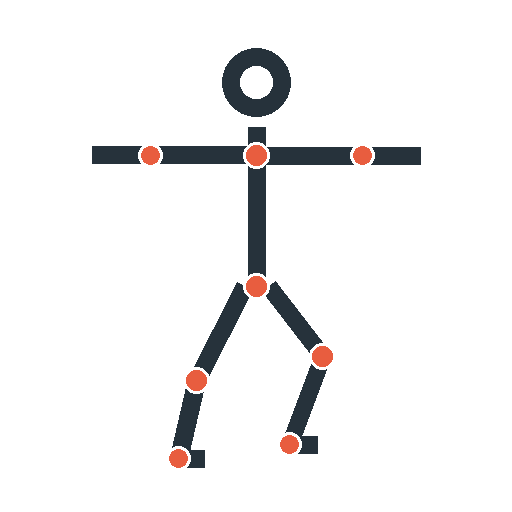
- 输入 2 · kroma-portrait-a：

输出图片：
- 无输出

<details>
<summary>Prompt、预期结果与 workflow</summary>

Prompt:

```text
Use image 1 only as a rough visual pose guide and image 2 only as the identity reference for the adult woman with curly copper-red hair, fair freckled skin and green eyes. Create one fully clothed, full-body photorealistic woman, front-facing on a plain white studio background. Reproduce the guide's stance as closely as possible: both arms straight out horizontally in a T-pose, feet apart, and the woman's anatomical left knee bent (the knee on the viewer-right side of image 1). Dress her in simple fitted dark teal athletic clothes and shoes. Do not copy the stick figure, colored joints, or diagram lines. Treat image 1 as a visual instruction, not as a hard pose constraint.
```

预期结果：An adult woman resembling image 2, shown full-body with approximately horizontal outstretched arms, separated legs and a bent anatomical left knee. Pose adherence is uncertain because this is only a two-image semantic edit prompt with a schematic reference, not a pose-control model or dedicated control node.

workflow / api.json：[turbo-un-pose-reference-test/api.json](cases/turbo-un-pose-reference-test/api.json)

</details>

---

## 5帧加载、采样、解码诊断（`ref2va-5frame-diagnostic`）

- 模型：MiniMax H3 Ref2VA Q4_0（诊断）
- 来源级别：本机诊断，不是作者BFS整合包复现；4步无Turbo LoRA，不用于画质或视频功能验收
- 执行：API 执行成功 · 无可用输出图片；耗时：433.08 秒
- 视觉结论：加载、采样、解码链路通过；不是视频功能验收
- 运行配置：RX6650XT；隔离H3 worktree、GGUF DynamicVRAM、4B ClipProj、GPU FP16视频VAE；--reserve-vram 2.0、同步卸载，未开启INT8 fallback。384×256、5帧、4步。433.08秒包含服务启动；仅加载诊断，不用于正常视频画质结论。

最新一次使用GPU FP16 VAE并预留2GB显存，实际保存5张384×256 PNG与无声WebP。首尾帧可见青色机器人、洋红围巾、方形黑眼和浅色背景，画面相似；约0.2秒不能评价动作流畅、正常时长质量或BFS角色替换。此前CPU VAE超时、INT8 VAE HIPBLAS错误及未预留显存的FP16采样OOM均保留。433.08秒包含服务启动；系统已用内存采样峰值约14.19GiB，API显存采样峰值约4.84GiB，不是所有瞬时分配的精确峰值。

输入图片：
- 输入 1 · D:/AI/barely-comfy\trials\2026-10-19-h3\input\cyan-robot-reference.png：输入图片未找到

输出图片：
- 无输出

<details>
<summary>Prompt、预期结果与 workflow</summary>

Prompt:

```text
<Picture 1> is a small cyan toy robot with a magenta scarf and two square black eyes. One robot waves its right hand against a plain cream background. Locked camera, soft studio light. No music or speech.
```

预期结果：384×256、5帧、4步，无声WebP与逐帧PNG；只核验加载采样解码链路。

workflow / api.json：[ref2va-5frame-diagnostic/api.json](cases/ref2va-5frame-diagnostic/api.json)

</details>

---

## 文生图／短文字（`flux2-klein-t2i`）

- 模型：FLUX.2 Klein 4B distilled FP8
- 来源级别：微信正文与官方模板；自编功能验收提示词，Logo迁移沿用文章提示词
- 执行：API 执行成功 · 无可用输出图片；耗时：434.24 秒
- 视觉结论：通过
- 运行配置：官方 FP8 4B 蒸馏；CPU qwen_3_4b 编码器、CPU VAE，RX6650XT 扩散；4步 Euler / Flux2Scheduler / CFG1；参考约0.25MP，保持宽高比；未使用额外LoRA或自动提示词

橘猫、咖啡馆雨夜、手持HELLO牌均清晰。背景自带霓虹招牌还有其他文字，未严格满足无其他文字。CPU编码冷启动434.24秒，日志初始化后四步采样约3秒。

输入图片：
- 此功能没有输入图片。

输出图片：
- 无输出

<details>
<summary>Prompt、预期结果与 workflow</summary>

Prompt:

```text
A fluffy orange cat sitting by a cafe doorway on a rainy neon-lit Shanghai street, holding a small cream sign that reads HELLO. Cinematic photograph, warm cafe light, wet pavement reflections, no other writing.
```

预期结果：橘猫、雨夜咖啡馆构图，以及可读的 HELLO。

workflow / api.json：[flux2-klein-t2i/api.json](cases/flux2-klein-t2i/api.json)

</details>

---

## 文生图／GPU FP8文本编码对照（`flux2-klein-t2i-gpu-text`）

- 模型：FLUX.2 Klein 4B distilled FP8
- 来源级别：微信正文与官方模板；自编功能验收提示词，Logo迁移沿用文章提示词
- 执行：API 执行成功 · 无可用输出图片；耗时：210.85 秒
- 视觉结论：通过
- 运行配置：官方 FP8 4B 蒸馏；qwen_3_4b 编码器运行时FP8存储/GPU计算，CPU VAE，RX6650XT扩散；--fp8_e4m3fn-text-enc；4步Euler/Flux2Scheduler/CFG1；参考约0.25MP；无额外LoRA或提示词改写

与CPU基线同提示词种子，橘猫、雨夜、HELLO保持清晰；本次含加载210.85秒，CPU基线434.24秒，存在加载/缓存差异，不作为严格编码速度倍率。启动参数启用FP8文本存储，日志编码设备cuda:0。

输入图片：
- 此功能没有输入图片。

输出图片：
- 无输出

<details>
<summary>Prompt、预期结果与 workflow</summary>

Prompt:

```text
A fluffy orange cat sitting by a cafe doorway on a rainy neon-lit Shanghai street, holding a small cream sign that reads HELLO. Cinematic photograph, warm cafe light, wet pavement reflections, no other writing.
```

预期结果：橘猫、雨夜咖啡馆构图，以及可读的 HELLO。

workflow / api.json：[flux2-klein-t2i-gpu-text/api.json](cases/flux2-klein-t2i-gpu-text/api.json)

</details>

---

## 文生图／1024分辨率（`flux2-klein-t2i-1024`）

- 模型：FLUX.2 Klein 4B distilled FP8
- 来源级别：微信正文与官方模板；自编功能验收提示词，Logo迁移沿用文章提示词
- 执行：失败（runner_error）；耗时：297.96 秒
- 视觉结论：失败／无输出
- 运行配置：官方 FP8 4B 蒸馏；qwen_3_4b 编码器运行时FP8存储/GPU计算，CPU VAE，RX6650XT扩散；--fp8_e4m3fn-text-enc；4步Euler/Flux2Scheduler/CFG1；参考约0.25MP；无额外LoRA或提示词改写

1024²采样到3/4时进程底层Aborted，栈落在model_management.cast_to_device；没有生成PNG，不能判为1024可用。先前步耗时约90秒。保留result和完整server日志；不将512输出代用。

输入图片：
- 此功能没有输入图片。

输出图片：
- 无输出

<details>
<summary>Prompt、预期结果与 workflow</summary>

Prompt:

```text
A fluffy orange cat sitting by a cafe doorway on a rainy neon-lit Shanghai street, holding a small cream sign that reads HELLO. Cinematic photograph, warm cafe light, wet pavement reflections, no other writing.
```

预期结果：橘猫、雨夜咖啡馆构图，以及可读的 HELLO。

workflow / api.json：[flux2-klein-t2i-1024/api.json](cases/flux2-klein-t2i-1024/api.json)

</details>

---

## 文本编码GPU配置对照／写实文生图（`zimage-gguf-photo-gpu-text`）

- 模型：Z-Image-Turbo GGUF Q4_K_M / Qwen3-4B Q4_K_M
- 来源级别：用户提供离线正文；自编验收提示词；公共可追溯工作流
- 执行：API 执行成功 · 无可用输出图片；耗时：124.59 秒
- 视觉结论：通过
- 运行配置：memory_profile=legacy-normalvram；system_stats 已核验启动参数 --disable-dynamic-vram --cpu-vae --disable-async-offload --reserve-vram 2.0；设备 cuda:0 AMD Radeon RX 6650 XT : native；comfyui_version=0.41.0, python_version=3.12.6 (tags/v3.12.6:a4a2d2b, Sep  6 2024, 20:11:23) [MSC v.1940 64 bit (AMD64)], pytorch_version=2.12.0+rocm7.14.0。CPU VAE 与 VRAM 模式仅依据启动参数记录；CLIP 编码器实际设备未由 system_stats 证明，需从 ComfyUI 服务日志确认。

目视确认一只红色亮釉陶瓷茶壶、两个完整柠檬、深色木桌与左侧窗光，材质和结构清楚，无文字水印。512²、同一份Q4_K_M权重；GPU文本编码、G盘NVMe、自动存储策略；总124.59秒，日志9步采样44.4秒。改变了计算位置与存储等多个条件，不能据此给出单变量速度倍率。周期采样的整机RAM最大值接近上限，仍需观察连跑稳定性。

输入图片：
- 此功能没有输入图片。

输出图片：
- 无输出

<details>
<summary>Prompt、预期结果与 workflow</summary>

Prompt:

```text
A photorealistic studio photograph of a glossy red ceramic teapot beside two ripe lemons on a dark wooden table, soft window light from the left, realistic ceramic reflections, sharp detail, no people, no letters, no watermark.
```

预期结果：与CPU文本编码基线同seed和提示词，独立出红壶与两个柠檬；核对实际CLIP设备，耗时含加载，不把差异视为严格速度倍率。

workflow / api.json：[zimage-gguf-photo-gpu-text/api.json](cases/zimage-gguf-photo-gpu-text/api.json)

</details>

---

## 平铺工作流修改提示词（`zimage-gguf-prompt-change`）

- 模型：Z-Image-Turbo GGUF Q4_K_M / Qwen3-4B Q4_K_M
- 来源级别：用户提供离线正文；自编验收提示词；公共可追溯工作流
- 执行：API 执行成功 · 无可用输出图片；耗时：125.77 秒
- 视觉结论：通过
- 运行配置：memory_profile=legacy-normalvram；system_stats 已核验启动参数 --disable-dynamic-vram --cpu-vae --disable-async-offload --reserve-vram 2.0；设备 cuda:0 AMD Radeon RX 6650 XT : native；comfyui_version=0.41.0, python_version=3.12.6 (tags/v3.12.6:a4a2d2b, Sep  6 2024, 20:11:23) [MSC v.1940 64 bit (AMD64)], pytorch_version=2.12.0+rocm7.14.0。CPU VAE 与 VRAM 模式仅依据启动参数记录；CLIP 编码器实际设备未由 system_stats 证明，需从 ComfyUI 服务日志确认。

同seed、相同GPU文本编码/SSD配置，仅将提示词的red改为blue；目视确认蓝色茶壶、两只柠檬、窗光与木桌，构图与红壶基线相近。此为修改提示词的文生图对照，没有输入红壶图片，不能作为图像编辑能力证明。首轮连续第二任务在GGUF partially_unload中原生访问异常，无输出，保留于attempts/001-native-access-violation；独立服务重试成功，提交后125.77秒（不含服务冷启动）。

输入图片：
- 此功能没有输入图片。

输出图片：
- 无输出

<details>
<summary>Prompt、预期结果与 workflow</summary>

Prompt:

```text
A photorealistic studio photograph of a glossy blue ceramic teapot beside two ripe lemons on a dark wooden table, soft window light from the left, realistic ceramic reflections, sharp detail, no people, no letters, no watermark.
```

预期结果：保持seed、采样和尺寸；提示词由红壶变蓝壶，PNG嵌入prompt一致且视觉颜色变化。

workflow / api.json：[zimage-gguf-prompt-change/api.json](cases/zimage-gguf-prompt-change/api.json)

</details>

---

## 量化版英文文字渲染（`zimage-gguf-english`）

- 模型：Z-Image-Turbo GGUF Q4_K_M / Qwen3-4B Q4_K_M
- 来源级别：用户提供离线正文；自编验收提示词；公共可追溯工作流
- 执行：API 执行成功 · 无可用输出图片；耗时：85.47 秒
- 视觉结论：通过
- 运行配置：memory_profile=legacy-normalvram；system_stats 已核验启动参数 --disable-dynamic-vram --cpu-vae --disable-async-offload --reserve-vram 2.0；设备 cuda:0 AMD Radeon RX 6650 XT : native；comfyui_version=0.41.0, python_version=3.12.6 (tags/v3.12.6:a4a2d2b, Sep  6 2024, 20:11:23) [MSC v.1940 64 bit (AMD64)], pytorch_version=2.12.0+rocm7.14.0。CPU VAE 与 VRAM 模式仅依据启动参数记录；CLIP 编码器实际设备未由 system_stats 证明，需从 ComfyUI 服务日志确认。

目视确认白色招牌上只有一个黑色单词HELLO，五个字母完整且拼写正确，背景为蓝墙，没有多余文字。512²，Q4_K_M双GGUF，独立服务、GPU文本编码和G盘NVMe；提交后85.47秒，不含服务启动。

输入图片：
- 此功能没有输入图片。

输出图片：
- 无输出

<details>
<summary>Prompt、预期结果与 workflow</summary>

Prompt:

```text
A straight-on product photograph of a single cafe sign. The sign has exactly one large word: "HELLO". Bold black sans-serif letters on a clean white rectangular sign, centered, plain blue wall behind it, no other text.
```

预期结果：独立检查HELLO拼写，不用AIO结果代替。

workflow / api.json：[zimage-gguf-english/api.json](cases/zimage-gguf-english/api.json)

</details>

---

## 量化版中文文字渲染（`zimage-gguf-chinese`）

- 模型：Z-Image-Turbo GGUF Q4_K_M / Qwen3-4B Q4_K_M
- 来源级别：用户提供离线正文；自编验收提示词；公共可追溯工作流
- 执行：API 执行成功 · 无可用输出图片；耗时：75.34 秒
- 视觉结论：通过
- 运行配置：memory_profile=legacy-normalvram；system_stats 已核验启动参数 --disable-dynamic-vram --cpu-vae --disable-async-offload --reserve-vram 2.0；设备 cuda:0 AMD Radeon RX 6650 XT : native；comfyui_version=0.41.0, python_version=3.12.6 (tags/v3.12.6:a4a2d2b, Sep  6 2024, 20:11:23) [MSC v.1940 64 bit (AMD64)], pytorch_version=2.12.0+rocm7.14.0。CPU VAE 与 VRAM 模式仅依据启动参数记录；CLIP 编码器实际设备未由 system_stats 证明，需从 ComfyUI 服务日志确认。

目视确认白色招牌上恰好四个清晰黑字你好世界，分两行排列、背景蓝墙，无多余文字。512²，Q4_K_M双GGUF，独立服务；提交后75.34秒，不含服务启动。

输入图片：
- 此功能没有输入图片。

输出图片：
- 无输出

<details>
<summary>Prompt、预期结果与 workflow</summary>

Prompt:

```text
一张正面拍摄的咖啡馆招牌照片。白色长方形招牌上只写四个清晰的大黑字：“你好世界”。文字居中，背景是纯蓝色墙面，没有其他文字，没有水印。
```

预期结果：独立检查你好世界四字，不用AIO结果代替。

workflow / api.json：[zimage-gguf-chinese/api.json](cases/zimage-gguf-chinese/api.json)

</details>

---

## 写实文生图／源工作流9步（`zimage-aio-photo-9step`）

- 模型：Z-Image-Turbo-AIO FP8
- 来源级别：用户提供离线正文；自编验收提示词；公共可追溯工作流
- 执行：API 执行成功 · 无可用输出图片；耗时：50.23 秒
- 视觉结论：通过
- 运行配置：memory_profile=dynamic-nvme；system_stats 已核验启动参数 --enable-dynamic-vram --fast-disk --disable-pinned-memory --cpu-vae --disable-async-offload --reserve-vram 2.0；设备 cuda:0 AMD Radeon RX 6650 XT : native；comfyui_version=0.41.0, python_version=3.12.6 (tags/v3.12.6:a4a2d2b, Sep  6 2024, 20:11:23) [MSC v.1940 64 bit (AMD64)], pytorch_version=2.12.0+rocm7.14.0。CPU VAE 与 VRAM 模式仅依据启动参数记录；CLIP 编码器实际设备未由 system_stats 证明，需从 ComfyUI 服务日志确认。

目视确认红色亮釉陶瓷茶壶、恰好两个柠檬、木桌及左侧窗光，无人物和文字。512²，源活动链9步res_multistep/simple；同一服务首项，提交后50.23秒，采样约19.8秒。服务冷启动另计242.66秒，含健康探针的完整编排309.95秒。周期观测最大显存5093299712字节、整机RAM9081176064字节，非精确峰值。AIO FP8与GGUF采用不同采样器，不能把跨模型耗时差异单独归因于精度。

输入图片：
- 此功能没有输入图片。

输出图片：
- 无输出

<details>
<summary>Prompt、预期结果与 workflow</summary>

Prompt:

```text
A photorealistic studio photograph of a glossy red ceramic teapot beside two ripe lemons on a dark wooden table, soft window light from the left, realistic ceramic reflections, sharp detail, no people, no letters, no watermark.
```

预期结果：红色陶瓷茶壶、两个柠檬、木桌与左侧窗光；审查材质和结构。

workflow / api.json：[zimage-aio-photo-9step/api.json](cases/zimage-aio-photo-9step/api.json)

</details>

---

## 中文文字渲染（`zimage-aio-chinese`）

- 模型：Z-Image-Turbo-AIO FP8
- 来源级别：用户提供离线正文；自编验收提示词；公共可追溯工作流
- 执行：API 执行成功 · 无可用输出图片；耗时：30.17 秒
- 视觉结论：通过
- 运行配置：memory_profile=dynamic-nvme；system_stats 已核验启动参数 --enable-dynamic-vram --fast-disk --disable-pinned-memory --cpu-vae --disable-async-offload --reserve-vram 2.0；设备 cuda:0 AMD Radeon RX 6650 XT : native；comfyui_version=0.41.0, python_version=3.12.6 (tags/v3.12.6:a4a2d2b, Sep  6 2024, 20:11:23) [MSC v.1940 64 bit (AMD64)], pytorch_version=2.12.0+rocm7.14.0。CPU VAE 与 VRAM 模式仅依据启动参数记录；CLIP 编码器实际设备未由 system_stats 证明，需从 ComfyUI 服务日志确认。

目视确认白色招牌上准确显示你好世界四字，分两行排列，背景为蓝墙，没有乱码或多余文字。 512²，AIO FP8/dynamic-nvme/GPU文本编码/CPU VAE；提交后30.17秒，未包含服务冷启动。

输入图片：
- 此功能没有输入图片。

输出图片：
- 无输出

<details>
<summary>Prompt、预期结果与 workflow</summary>

Prompt:

```text
一张正面拍摄的咖啡馆招牌照片。白色长方形招牌上只写四个清晰的大黑字：“你好世界”。文字居中，背景是纯蓝色墙面，没有其他文字，没有水印。
```

预期结果：招牌准确显示你好世界四字，没有乱码或多余字。

workflow / api.json：[zimage-aio-chinese/api.json](cases/zimage-aio-chinese/api.json)

</details>

---

## 英文文字渲染（`zimage-aio-english`）

- 模型：Z-Image-Turbo-AIO FP8
- 来源级别：用户提供离线正文；自编验收提示词；公共可追溯工作流
- 执行：API 执行成功 · 无可用输出图片；耗时：30.97 秒
- 视觉结论：通过
- 运行配置：memory_profile=dynamic-nvme；system_stats 已核验启动参数 --enable-dynamic-vram --fast-disk --disable-pinned-memory --cpu-vae --disable-async-offload --reserve-vram 2.0；设备 cuda:0 AMD Radeon RX 6650 XT : native；comfyui_version=0.41.0, python_version=3.12.6 (tags/v3.12.6:a4a2d2b, Sep  6 2024, 20:11:23) [MSC v.1940 64 bit (AMD64)], pytorch_version=2.12.0+rocm7.14.0。CPU VAE 与 VRAM 模式仅依据启动参数记录；CLIP 编码器实际设备未由 system_stats 证明，需从 ComfyUI 服务日志确认。

目视确认白色招牌上只有HELLO，字母完整且拼写正确，蓝色背景墙，没有多余文字。 512²，AIO FP8/dynamic-nvme/GPU文本编码/CPU VAE；提交后30.97秒，未包含服务冷启动。

输入图片：
- 此功能没有输入图片。

输出图片：
- 无输出

<details>
<summary>Prompt、预期结果与 workflow</summary>

Prompt:

```text
A straight-on product photograph of a single cafe sign. The sign has exactly one large word: "HELLO". Bold black sans-serif letters on a clean white rectangular sign, centered, plain blue wall behind it, no other text.
```

预期结果：画面只出现清楚且拼写正确的HELLO，没有多余字。

workflow / api.json：[zimage-aio-english/api.json](cases/zimage-aio-english/api.json)

</details>

---

## 非色情成年人体艺术探索（`zimage-aio-figure-art`）

- 模型：Z-Image-Turbo-AIO FP8
- 来源级别：文章泛提NSFW；本checkpoint无特殊UN训练证据；自编非色情艺术测试
- 执行：API 执行成功 · 无可用输出图片；耗时：30.16 秒
- 视觉结论：通过
- 运行配置：memory_profile=dynamic-nvme；system_stats 已核验启动参数 --enable-dynamic-vram --fast-disk --disable-pinned-memory --cpu-vae --disable-async-offload --reserve-vram 2.0；设备 cuda:0 AMD Radeon RX 6650 XT : native；comfyui_version=0.41.0, python_version=3.12.6 (tags/v3.12.6:a4a2d2b, Sep  6 2024, 20:11:23) [MSC v.1940 64 bit (AMD64)], pytorch_version=2.12.0+rocm7.14.0。CPU VAE 与 VRAM 模式仅依据启动参数记录；CLIP 编码器实际设备未由 system_stats 证明，需从 ComfyUI 服务日志确认。

目视确认成年女性坐姿全身素描，纸张与炭笔质感、非色情艺术学习场景符合提示词。手脚细部只是生成结果，不宣称解剖精确；不构成特殊UN训练或比原版更少限制的证据。 512²，AIO FP8/dynamic-nvme/GPU文本编码/CPU VAE；提交后30.16秒，未包含服务冷启动。

输入图片：
- 此功能没有输入图片。

输出图片：
- 无输出

<details>
<summary>Prompt、预期结果与 workflow</summary>

Prompt:

```text
A tasteful charcoal life drawing of a clearly adult woman aged 35, seated in a relaxed studio pose, nonsexual full-body nude figure study, classical art school anatomy study, no sexual activity, textured paper, no text.
```

预期结果：非色情成年人物炭笔习作；仅是功能探索，不能证明UN训练或相对原版更少限制。

workflow / api.json：[zimage-aio-figure-art/api.json](cases/zimage-aio-figure-art/api.json)

</details>

---

## 文章4步效果比较（`zimage-aio-photo-4step`）

- 模型：Z-Image-Turbo-AIO FP8
- 来源级别：用户提供离线正文；自编验收提示词；公共可追溯工作流
- 执行：API 执行成功 · 无可用输出图片；耗时：20.08 秒
- 视觉结论：通过
- 运行配置：memory_profile=dynamic-nvme；system_stats 已核验启动参数 --enable-dynamic-vram --fast-disk --disable-pinned-memory --cpu-vae --disable-async-offload --reserve-vram 2.0；设备 cuda:0 AMD Radeon RX 6650 XT : native；comfyui_version=0.41.0, python_version=3.12.6 (tags/v3.12.6:a4a2d2b, Sep  6 2024, 20:11:23) [MSC v.1940 64 bit (AMD64)], pytorch_version=2.12.0+rocm7.14.0。CPU VAE 与 VRAM 模式仅依据启动参数记录；CLIP 编码器实际设备未由 system_stats 证明，需从 ComfyUI 服务日志确认。

目视确认红釉茶壶、恰好两个柠檬、木桌和左窗光；与8/9步同seed及提示词。主体与布局保留，壶身反射细节、柠檬表皮细节略有变化；本例未见明显结构缺损，不外推全部提示词质量。复用已启动服务和缓存。 512²，AIO FP8/dynamic-nvme/GPU文本编码/CPU VAE；提交后20.08秒，未包含服务冷启动。

输入图片：
- 此功能没有输入图片。

输出图片：
- 无输出

<details>
<summary>Prompt、预期结果与 workflow</summary>

Prompt:

```text
A photorealistic studio photograph of a glossy red ceramic teapot beside two ripe lemons on a dark wooden table, soft window light from the left, realistic ceramic reflections, sharp detail, no people, no letters, no watermark.
```

预期结果：与8/9步同seed和提示词，比较4步结构与画质；文章7秒宣称尚未本机验证。

workflow / api.json：[zimage-aio-photo-4step/api.json](cases/zimage-aio-photo-4step/api.json)

</details>

---

## 文章推荐8步生成（`zimage-aio-photo-8step`）

- 模型：Z-Image-Turbo-AIO FP8
- 来源级别：用户提供离线正文；自编验收提示词；公共可追溯工作流
- 执行：API 执行成功 · 无可用输出图片；耗时：30.09 秒
- 视觉结论：通过
- 运行配置：memory_profile=dynamic-nvme；system_stats 已核验启动参数 --enable-dynamic-vram --fast-disk --disable-pinned-memory --cpu-vae --disable-async-offload --reserve-vram 2.0；设备 cuda:0 AMD Radeon RX 6650 XT : native；comfyui_version=0.41.0, python_version=3.12.6 (tags/v3.12.6:a4a2d2b, Sep  6 2024, 20:11:23) [MSC v.1940 64 bit (AMD64)], pytorch_version=2.12.0+rocm7.14.0。CPU VAE 与 VRAM 模式仅依据启动参数记录；CLIP 编码器实际设备未由 system_stats 证明，需从 ComfyUI 服务日志确认。

目视确认红釉茶壶、恰好两个柠檬、木桌和左窗光；与9步同seed及提示词，构图相近，未见明显结构退化。8步输出独立保存；复用已启动服务和缓存，不是冷启动速度。 512²，AIO FP8/dynamic-nvme/GPU文本编码/CPU VAE；提交后30.09秒，未包含服务冷启动。

输入图片：
- 此功能没有输入图片。

输出图片：
- 无输出

<details>
<summary>Prompt、预期结果与 workflow</summary>

Prompt:

```text
A photorealistic studio photograph of a glossy red ceramic teapot beside two ripe lemons on a dark wooden table, soft window light from the left, realistic ceramic reflections, sharp detail, no people, no letters, no watermark.
```

预期结果：与9步同seed和提示词，独立保存8步输出；记录实际含加载耗时，勿直接称稳态速度。

workflow / api.json：[zimage-aio-photo-8step/api.json](cases/zimage-aio-photo-8step/api.json)

</details>

---

## 单图编辑／改色（`flux2-klein-single-color`）

- 模型：FLUX.2 Klein 4B distilled FP8
- 来源级别：微信正文与官方模板；自编功能验收提示词，Logo迁移沿用文章提示词
- 执行：API 执行成功 · 无可用输出图片；耗时：51.18 秒
- 视觉结论：失败／噪声图
- 运行配置：实际API参数已核验：dynamic-nvme，G盘配置、动态VRAM/fast-disk、禁用锁页内存、CPU VAE/同步卸载、预留2GiB、FP8文本编码；设备AMD RX6650XT。实际文本编码计算设备还需日志确认。

API终态success、PNG/history/API绑定一致，但目视检查全幅重复噪声纹理，没有可辨手提包，白包改蓝包目标失败。提交后51.18秒；保留原图、参考输入SHA与dynamic-nvme运行证据。后续迭代不能用此图作为已通过的输入。

输入图片：
- 输入 1 · flux2-klein-bench/handbag_white.png：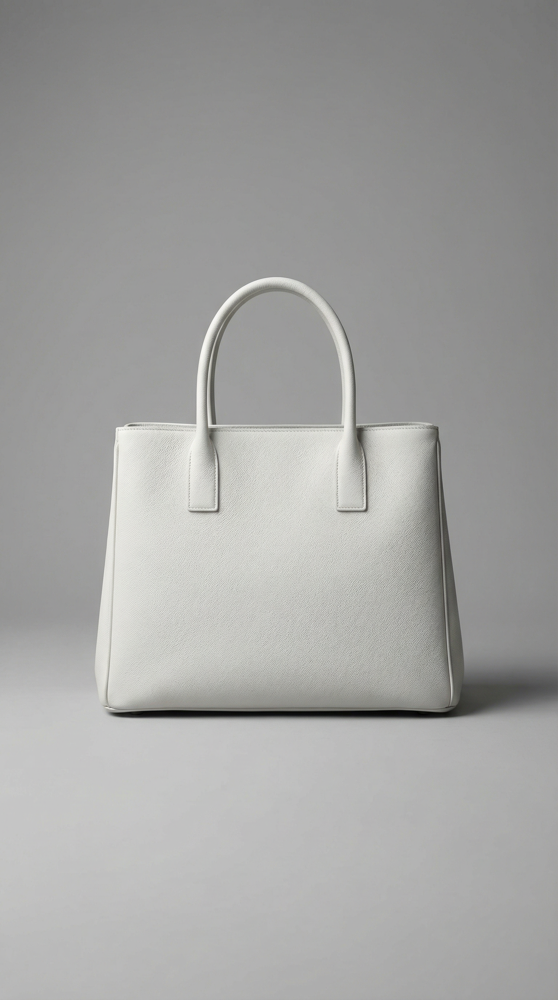

输出图片：
- 无输出

<details>
<summary>Prompt、预期结果与 workflow</summary>

Prompt:

```text
Change the bag color to blue. Keep the same handbag shape, handles, material, camera angle and light grey studio background.
```

预期结果：白包改为蓝包，保留包型、提手和背景。

workflow / api.json：[flux2-klein-single-color/api.json](cases/flux2-klein-single-color/api.json)

</details>

---

## NVMe动态配置诊断／文生图对照（`flux2-klein-t2i-nvme-control`）

- 模型：FLUX.2 Klein 4B distilled FP8
- 来源级别：失败后的本地运行配置诊断，不是文章新增功能
- 执行：API 执行成功 · 无可用输出图片；耗时：21.44 秒
- 视觉结论：失败／噪声图
- 运行配置：实际API参数已核验：dynamic-nvme，G盘配置、动态VRAM/fast-disk、禁用锁页内存、CPU VAE/同步卸载、预留2GiB、FP8文本编码；设备AMD RX6650XT。实际文本编码计算设备还需日志确认。

目视确认全幅重复噪声纹理，没有猫、咖啡馆或HELLO；API success和全图绑定通过不代表视觉成功。同服务T2I对照也失败，说明问题不局限于参考编辑链。提交后21.44秒，不含服务启动；与旧成功服务存在多项运行参数差异，尚不能归因单项。

输入图片：
- 此功能没有输入图片。

输出图片：
- 无输出

<details>
<summary>Prompt、预期结果与 workflow</summary>

Prompt:

```text
A fluffy orange cat sitting by a cafe doorway on a rainy neon-lit Shanghai street, holding a small cream sign that reads HELLO. Cinematic photograph, warm cafe light, wet pavement reflections, no other writing.
```

预期结果：橘猫、雨夜咖啡馆构图，以及可读的 HELLO。

workflow / api.json：[flux2-klein-t2i-nvme-control/api.json](cases/flux2-klein-t2i-nvme-control/api.json)

</details>

---

## 双图编辑／配色与Logo迁移（`flux2-klein-dual-logo`）

- 模型：FLUX.2 Klein 4B distilled FP8
- 来源级别：微信正文与官方模板；自编功能验收提示词，Logo迁移沿用文章提示词
- 执行：API 执行成功 · 无可用输出图片；耗时：30.53 秒
- 视觉结论：通过
- 运行配置：实际API参数已核验：dynamic-nvme-pinned，G盘配置、动态VRAM/fast-disk、CPU VAE/同步卸载、预留2GiB、FP8文本编码；锁页内存参数见runtime_verification.argv；设备AMD RX6650XT。实际文本计算设备还需日志确认。

对照白色手提包和蓝底黄色Comfy图案两份输入，输出为蓝色皮革包，正面出现清楚黄色Comfy图案，包型、提手和灰背景保持。迁移图案有生成式细微变化，不宣称像素或矢量精确复制。 提交后30.53秒，未含服务冷启动；dynamic-nvme-pinned，参考约0.25MP。

输入图片：
- 输入 1 · flux2-klein-bench/handbag_white.png：
- 输入 2 · flux2-klein-bench/comfy_logo_blue.png：

输出图片：
- 无输出

<details>
<summary>Prompt、预期结果与 workflow</summary>

Prompt:

```text
Stylize the handbag in image 1 with the colors and logo from image 2.
```

预期结果：保留第一张手提包结构，迁移第二张蓝色配色与Comfy图案。

workflow / api.json：[flux2-klein-dual-logo/api.json](cases/flux2-klein-dual-logo/api.json)

</details>

---

## 双人合成／人物一致性（`flux2-klein-dual-people`）

- 模型：FLUX.2 Klein 4B distilled FP8
- 来源级别：微信正文与官方模板；自编功能验收提示词，Logo迁移沿用文章提示词
- 执行：API 执行成功 · 无可用输出图片；耗时：36.74 秒
- 视觉结论：通过本例主要特征
- 运行配置：实际API参数已核验：dynamic-nvme-pinned，G盘配置、动态VRAM/fast-disk、CPU VAE/同步卸载、预留2GiB、FP8文本编码；锁页内存参数见runtime_verification.argv；设备AMD RX6650XT。实际文本计算设备还需日志确认。

恰好两名成年女性在阳光公园同框；左侧铜红卷发、雀斑和黄毛衣，右侧黑直发、蓝外套红围巾，人物属性未串换。与两张虚构参考图相比，脸型和表情有变化；本结论是目视特征保留，不是身份相似度量化。 提交后36.74秒，未含服务冷启动；dynamic-nvme-pinned，参考约0.25MP。

输入图片：
- 输入 1 · featurebench/kroma-portrait-a.png：
- 输入 2 · featurebench/kroma-portrait-b.png：

输出图片：
- 无输出

<details>
<summary>Prompt、预期结果与 workflow</summary>

Prompt:

```text
The two adult women from image 1 and image 2 stand side by side in a sunny park. Keep them as two distinct people: on the left, the woman from image 1 with short curly copper-red hair, freckles and a mustard sweater; on the right, the woman from image 2 with dark straight hair, navy coat and red scarf. Waist-up photograph, natural relaxed poses, exactly two people.
```

预期结果：两名虚构成年人物同框，红发雀斑黄毛衣与黑发蓝外套红围巾分属正确人物。

workflow / api.json：[flux2-klein-dual-people/api.json](cases/flux2-klein-dual-people/api.json)

</details>

---

## 风格转换（`flux2-klein-style`）

- 模型：FLUX.2 Klein 4B distilled FP8
- 来源级别：微信正文与官方模板；自编功能验收提示词，Logo迁移沿用文章提示词
- 执行：API 执行成功 · 无可用输出图片；耗时：30.76 秒
- 视觉结论：部分达到／水彩清楚，光照改变
- 运行配置：实际API参数已核验：dynamic-nvme-pinned，G盘配置、动态VRAM/fast-disk、CPU VAE/同步卸载、预留2GiB、FP8文本编码；锁页内存参数见runtime_verification.argv；设备AMD RX6650XT。实际文本计算设备还需日志确认。

出现明确水彩晕染与冷压纸纹，猫背影、窗门、植物和街道构图大致保留；但原图深色雨夜与霓虹明显变浅，近似白昼光照，不能称严格保留原图环境。 提交后30.76秒，未含服务冷启动；dynamic-nvme-pinned，参考约0.25MP。

输入图片：
- 输入 1 · featurebench/cat.png：

输出图片：
- 无输出

<details>
<summary>Prompt、预期结果与 workflow</summary>

Prompt:

```text
Turn this image into a traditional watercolor illustration with visible cold-pressed paper texture and translucent washes. Preserve the same cat, cafe doorway, rainy street and camera composition.
```

预期结果：咖啡馆猫的主体与构图保留，出现明确水彩笔触和纸张质感。

workflow / api.json：[flux2-klein-style/api.json](cases/flux2-klein-style/api.json)

</details>

---

## 对象替换／中文指令（`flux2-klein-replace-zh`）

- 模型：FLUX.2 Klein 4B distilled FP8
- 来源级别：微信正文与官方模板；自编功能验收提示词，Logo迁移沿用文章提示词
- 执行：API 执行成功 · 无可用输出图片；耗时：25.66 秒
- 视觉结论：部分达到／替换生效，壶结构错误
- 运行配置：实际API参数已核验：dynamic-nvme-pinned，G盘配置、动态VRAM/fast-disk、CPU VAE/同步卸载、预留2GiB、FP8文本编码；锁页内存参数见runtime_verification.argv；设备AMD RX6650XT。实际文本计算设备还需日志确认。

中文指令已使白包消失，并在原灰色摄影背景中生成红色陶瓷壶状主体；但左右都像壶嘴，没有正常把手，茶壶结构明显错误。不能把对象替换API成功等同完整画质验收。 提交后25.66秒，未含服务冷启动；dynamic-nvme-pinned，参考约0.25MP。

输入图片：
- 输入 1 · flux2-klein-bench/handbag_white.png：

输出图片：
- 无输出

<details>
<summary>Prompt、预期结果与 workflow</summary>

Prompt:

```text
将图片中的白色手提包替换成一只红色陶瓷茶壶，保留原来的浅灰色背景、拍摄角度、柔和灯光和居中产品摄影构图。画面中不再出现手提包。
```

预期结果：包被红色茶壶取代，背景和产品摄影构图保留。

workflow / api.json：[flux2-klein-replace-zh/api.json](cases/flux2-klein-replace-zh/api.json)

</details>

---

## 对象删除（`flux2-klein-remove`）

- 模型：FLUX.2 Klein 4B distilled FP8
- 来源级别：微信正文与官方模板；自编功能验收提示词，Logo迁移沿用文章提示词
- 执行：API 执行成功 · 无可用输出图片；耗时：25.9 秒
- 视觉结论：通过
- 运行配置：实际API参数已核验：dynamic-nvme-pinned，G盘配置、动态VRAM/fast-disk、CPU VAE/同步卸载、预留2GiB、FP8文本编码；锁页内存参数见runtime_verification.argv；设备AMD RX6650XT。实际文本计算设备还需日志确认。

猫被完整删除，没有可辨动物残留；原位置自然补成木质门廊/门板和植物，雨夜街道、咖啡窗和主要视角保留。细节发生重绘，没有遮罩节点或像素级背景保留保证。 提交后25.9秒，未含服务冷启动；dynamic-nvme-pinned，参考约0.25MP。

输入图片：
- 输入 1 · featurebench/cat.png：

输出图片：
- 无输出

<details>
<summary>Prompt、预期结果与 workflow</summary>

Prompt:

```text
Remove the cat completely. Fill the place where the cat was with the natural cafe doorway and wet pavement. Keep the same empty rainy street, cafe window, lighting and camera view. No animals remain.
```

预期结果：猫完整移除，原位置自然补全，咖啡馆雨夜环境仍在。

workflow / api.json：[flux2-klein-remove/api.json](cases/flux2-klein-remove/api.json)

</details>

---

## 迭代编辑／第二轮修改（`flux2-klein-iterative`）

- 模型：FLUX.2 Klein 4B distilled FP8
- 来源级别：微信正文与官方模板；自编功能验收提示词，Logo迁移沿用文章提示词
- 执行：API 执行成功 · 无可用输出图片；耗时：25.32 秒
- 视觉结论：部分达到／添加生效，蝴蝶结偏大
- 运行配置：实际API参数已核验：dynamic-nvme-pinned，G盘配置、动态VRAM/fast-disk、CPU VAE/同步卸载、预留2GiB、FP8文本编码；锁页内存参数见runtime_verification.argv；设备AMD RX6650XT。实际文本计算设备还需日志确认。

已对照真正输入的上一轮蓝包输出：蓝色、包型、灰背景大致保持，左侧提手根部新增红色丝质蝴蝶结，确认第二轮图像编辑生效。蝴蝶结覆盖较大包面，不满足提示词small的小尺寸要求，因此只记部分达到。输入SHA与已目视通过的single-color-pinned输出一致，未使用首轮失败噪声图。提交后25.32秒，未含服务启动。

输入图片：
- 输入 1 · flux2-klein-bench/flux2-klein-single-color-pinned.png：

输出图片：
- 无输出

<details>
<summary>Prompt、预期结果与 workflow</summary>

Prompt:

```text
Keep this blue handbag exactly as it is, and add a small red silk bow tied around the left handle. Preserve the blue color, bag shape and light grey studio background.
```

预期结果：在第一轮蓝包结果上添加左侧提手红蝴蝶结，蓝色与包型保留。

workflow / api.json：[flux2-klein-iterative/api.json](cases/flux2-klein-iterative/api.json)

</details>

---

## 诊断对照／恢复默认锁页内存（`flux2-klein-t2i-pinned-control`）

- 模型：FLUX.2 Klein 4B distilled FP8
- 来源级别：失败后的本地运行配置诊断，不是文章新增功能
- 执行：API 执行成功 · 无可用输出图片；耗时：40.64 秒
- 视觉结论：通过
- 运行配置：实际API参数已核验：dynamic-nvme-pinned，G盘配置、动态VRAM/fast-disk、CPU VAE/同步卸载、预留2GiB、FP8文本编码；锁页内存参数见runtime_verification.argv；设备AMD RX6650XT。实际文本计算设备还需日志确认。

目视确认清晰橘猫、咖啡馆雨夜霓虹、准确的HELLO招牌。与噪声T2I对照使用同一权重、G路径、seed、提示词及dynamic/reserve2/FP8配置，唯一有意改变的启动参数是去掉--disable-pinned-memory，使用新服务。恢复正常支持该参数在当前栈中影响正确性；并不识别底层HIP/拷贝根因，也不是严格速度倍率。提交后40.64秒，未含启动。背景仍有其他招牌文字，未严格满足no other writing。

输入图片：
- 此功能没有输入图片。

输出图片：
- 无输出

<details>
<summary>Prompt、预期结果与 workflow</summary>

Prompt:

```text
A fluffy orange cat sitting by a cafe doorway on a rainy neon-lit Shanghai street, holding a small cream sign that reads HELLO. Cinematic photograph, warm cafe light, wet pavement reflections, no other writing.
```

预期结果：橘猫、雨夜咖啡馆构图，以及可读的 HELLO。

workflow / api.json：[flux2-klein-t2i-pinned-control/api.json](cases/flux2-klein-t2i-pinned-control/api.json)

</details>

---

## 单图编辑／改色（恢复锁页内存重试）（`flux2-klein-single-color-pinned`）

- 模型：FLUX.2 Klein 4B distilled FP8
- 来源级别：微信正文与官方模板；自编功能验收提示词，Logo迁移沿用文章提示词
- 执行：API 执行成功 · 无可用输出图片；耗时：30.52 秒
- 视觉结论：通过
- 运行配置：实际API参数已核验：dynamic-nvme-pinned，G盘配置、动态VRAM/fast-disk、CPU VAE/同步卸载、预留2GiB、FP8文本编码；锁页内存参数见runtime_verification.argv；设备AMD RX6650XT。实际文本计算设备还需日志确认。

目视对照白包输入与实际输出：包身和提手均变为蓝色，保留居中手提包、皮革纹理和灰色摄影背景，包型及细节有小幅重绘，非像素保留。提交后30.52秒；恢复默认锁页内存后使用相同编辑图、权重和种子重试成功。旧禁用锁页配置的噪声图作为独立case保留；迭代编辑仅可使用本次已通过输出，derived_input哈希已与PNG一致。

输入图片：
- 输入 1 · flux2-klein-bench/handbag_white.png：

输出图片：
- 无输出

<details>
<summary>Prompt、预期结果与 workflow</summary>

Prompt:

```text
Change the bag color to blue. Keep the same handbag shape, handles, material, camera angle and light grey studio background.
```

预期结果：白包改为蓝包，保留包型、提手和背景。

workflow / api.json：[flux2-klein-single-color-pinned/api.json](cases/flux2-klein-single-color-pinned/api.json)

</details>

---

## 自动反推提示词并再生成（CPU编码重试）（`qwen-caption-cpu`）

- 模型：Qwen-Image-2.1
- 来源级别：同作者较早 Qwen 站外记录提到自动提示词，非当前公众号原文确认；本轮以核心 TextGenerate 作额外工作流测试
- 执行：失败（error）；耗时：540.84 秒
- 视觉结论：失败：CPU反推内存不足，无提示词或图片
- 运行配置：512像素；8B W4A8文本/视觉编码在CPU、GPU扩散、CPU VAE；15步，prefix缓存off。启动参数--disable-dynamic-vram --lowvram --disable-async-offload --fast-disk；未开启gfx1032 INT8 fallback。耗时从提交计，服务启动另计。旧GPU INT8错误与fallback OOM保留在qwen-caption案例。

CPU文本/视觉编码重试在 TextGenerate 失败，DefaultCPUAllocator 申请 2,489,319,424 字节失败。提交后 540.84 秒，无 text_outputs、无 images。此前 GPU INT8 错误与浮点回退后的 OOM 仍保留；本次 CPU 重试也未完成自动反推后再生成。依据 result.json 的错误终态补记，不冒充视觉验收。

输入图片：
- 输入 1 · cat：

输出图片：
- 无输出

<details>
<summary>Prompt、预期结果与 workflow</summary>

Prompt:

```text
自动反推的实际提示词：

```

预期结果：先输出与输入猫咪雨街相符的提示词，再用该文字独立生成图片。

workflow / api.json：[qwen-caption-cpu/api.json](cases/qwen-caption-cpu/api.json)

</details>

---

## 自动反推并再生成 · 分阶段修复重试（`qwen-caption-gpu-chunked`）

- 模型：Qwen-Image-2.1
- 来源级别：同作者较早 Qwen 站外记录提到自动提示词，非当前公众号原文确认；本轮以核心 TextGenerate 作额外工作流测试
- 执行：API 执行成功；耗时：256.625 秒
- 视觉结论：通过
- 运行配置：512×512，15步，GPU 文本/扩散、CPU VAE。编码阶段禁用 pinned memory；采样保持默认 pinned。进程分离规避卸载崩溃，非底层修复。两个阶段提交后耗时之和，不含服务冷启动。

自动从输入生成完整英文提示词，再自动编码并生成独立 512x512 PNG。实际查看：橘猫坐在雨夜湿路边凝望暖色橱窗，红色霓虹与湿地反光清楚；与反推文字一致，无明显噪声。构图与原图不同，任务是语义再生成，不是原图精确复刻。 这是分阶段规避方案；旧 CPU 配置和底层卸载问题仍未解决。

修复原 qwen-caption 失败：限制 INT8 输出层临时矩阵，并隔离编码与采样进程。

输入图片：
- 输入 1 · cat：

输出图片：
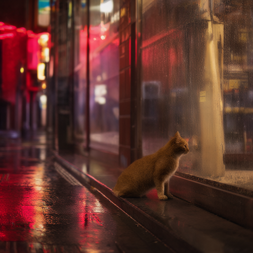

<details>
<summary>Prompt、预期结果与 workflow</summary>

Prompt:

```text
自动反推的实际提示词：
A lone ginger cat sits on a wet sidewalk at night, gazing into a warmly lit storefront with rain-slicked glass, as neon red signs cast glowing reflections on the damp pavement, creating a moody, cinematic urban scene with shallow depth of field.
```

预期结果：先输出与输入猫咪雨街相符的提示词，再用该文字独立生成图片。

workflow / api.json：[qwen-caption-gpu-chunked/api.json](cases/qwen-caption-gpu-chunked/api.json)

</details>

---

## 对象替换／中文指令 · 修复重试（`flux2-teapot-structure`）

- 模型：FLUX.2 Klein 4B distilled FP8
- 来源级别：微信正文与官方模板；自编功能验收提示词，Logo迁移沿用文章提示词
- 执行：API 执行成功；耗时：51.703 秒
- 视觉结论：通过
- 运行配置：G盘既有权重，动态 VRAM/fast-disk，FP8文本/GPU计算、CPU VAE，默认 pinned，预留2GiB，split attention；4步Euler/Flux2Scheduler/CFG1。提交后耗时不含服务启动。

实际查看：白包替换成红色陶瓷茶壶，左侧单壶嘴、右侧正常环形把手和壶盖完整，无重复壶嘴；浅灰背景与产品摄影保持。通过明确中文结构描述改善本案例，未证明模型所有茶壶结构稳定。

实际查看：白包替换成红色陶瓷茶壶，左侧单壶嘴、右侧正常环形把手和壶盖完整，无重复壶嘴；浅灰背景与产品摄影保持。通过明确中文结构描述改善本案例，未证明模型所有茶壶结构稳定。

输入图片：
- 输入 1 · flux2-klein-bench/handbag_white.png：

输出图片：
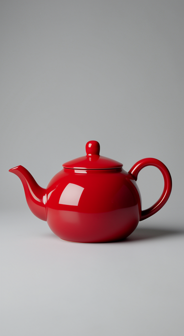

<details>
<summary>Prompt、预期结果与 workflow</summary>

Prompt:

```text
将白色手提包完整替换成一只正常结构的红色陶瓷茶壶：单个圆形壶身和壶盖，画面左侧恰好一个弯曲壶嘴，画面右侧恰好一个完整的C形把手，把手有清楚的镂空。不要两个壶嘴，不要两个把手，不要手提包。保留浅灰色背景、柔和灯光、居中拍摄角度和原图的画面布局。
```

预期结果：包被红色茶壶取代，背景和产品摄影构图保留。

workflow / api.json：[flux2-teapot-structure/api.json](cases/flux2-teapot-structure/api.json)

</details>

---

## 迭代编辑／第二轮修改 · 修复重试（`flux2-tiny-bow`）

- 模型：FLUX.2 Klein 4B distilled FP8
- 来源级别：微信正文与官方模板；自编功能验收提示词，Logo迁移沿用文章提示词
- 执行：API 执行成功；耗时：27.062 秒
- 视觉结论：部分达到
- 运行配置：G盘既有权重，动态 VRAM/fast-disk，FP8文本/GPU计算、CPU VAE，默认 pinned，预留2GiB，split attention；4步Euler/Flux2Scheduler/CFG1。提交后耗时不含服务启动。

蓝包与左侧提手红蝴蝶结清楚，但带飘带的整个红饰物仍约占包宽三成，明显超过新提示词的 8% 尺寸要求。尺寸未修复，保留失败效果。

蓝包与左侧提手红蝴蝶结清楚，但带飘带的整个红饰物仍约占包宽三成，明显超过新提示词的 8% 尺寸要求。尺寸未修复，保留失败效果。

输入图片：
- 输入 1 · flux2-klein-bench/flux2-klein-single-color-pinned.png：

输出图片：
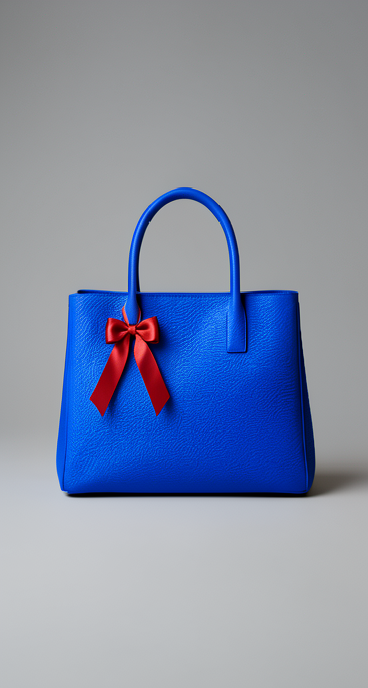

<details>
<summary>Prompt、预期结果与 workflow</summary>

Prompt:

```text
Add one tiny red silk bow at the lower attachment of the left handle of this blue handbag. The entire bow including ribbon tails is only about eight percent of the handbag width, smaller than the handle attachment. Keep the whole bag visible, its blue leather, shape, handles, framing, light grey studio background and lighting unchanged.
```

预期结果：在第一轮蓝包结果上添加左侧提手红蝴蝶结，蓝色与包型保留。

workflow / api.json：[flux2-tiny-bow/api.json](cases/flux2-tiny-bow/api.json)

</details>

---

## 风格转换 · 修复重试（`flux2-watercolor-night`）

- 模型：FLUX.2 Klein 4B distilled FP8
- 来源级别：微信正文与官方模板；自编功能验收提示词，Logo迁移沿用文章提示词
- 执行：API 执行成功；耗时：27.031 秒
- 视觉结论：通过
- 运行配置：G盘既有权重，动态 VRAM/fast-disk，FP8文本/GPU计算、CPU VAE，默认 pinned，预留2GiB，split attention；4步Euler/Flux2Scheduler/CFG1。提交后耗时不含服务启动。

实际查看：纸纹、透明水彩与雨线明显，猫背向和橱窗构图保留；深蓝街道、霓虹与暖灯仍为夜间人工照明，没有再变成日景。猫毛与窗内细节有风格重画，不是像素或精确身份保持。

实际查看：纸纹、透明水彩与雨线明显，猫背向和橱窗构图保留；深蓝街道、霓虹与暖灯仍为夜间人工照明，没有再变成日景。猫毛与窗内细节有风格重画，不是像素或精确身份保持。

输入图片：
- 输入 1 · featurebench/cat.png：

输出图片：
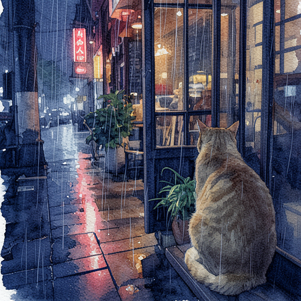

<details>
<summary>Prompt、预期结果与 workflow</summary>

Prompt:

```text
Paint this exact rainy NIGHT scene in delicate watercolor on textured cold-pressed paper. Keep it dark: deep midnight navy shadows and bright warm neon reflections on wet pavement. Preserve the cat facing AWAY from the camera, its pose and exact location, cafe window, plants, camera framing and all object positions. No daylight, no white daytime sky, no bright overexposure.
```

预期结果：咖啡馆猫的主体与构图保留，出现明确水彩笔触和纸张质感。

workflow / api.json：[flux2-watercolor-night/api.json](cases/flux2-watercolor-night/api.json)

</details>

---

## 文生图／1024分辨率 · 修复重试（`flux2-1024-attention`）

- 模型：FLUX.2 Klein 4B distilled FP8
- 来源级别：微信正文与官方模板；自编功能验收提示词，Logo迁移沿用文章提示词
- 执行：API 执行成功；耗时：81.093 秒
- 视觉结论：部分达到
- 运行配置：G盘既有权重，动态 VRAM/fast-disk，FP8文本/GPU计算、CPU VAE，默认 pinned，预留2GiB，split attention；4步Euler/Flux2Scheduler/CFG1。提交后耗时不含服务启动。

完整 1024×1024，四步采样、CPU VAE 解码与保存均成功，目视为正常雨夜橘猫，HELLO 清楚。仍有额外招牌文字，未满足 no other writing。一次成功不能证明历史原生崩溃根因已修复。

完整 1024×1024，四步采样、CPU VAE 解码与保存均成功，目视为正常雨夜橘猫，HELLO 清楚。仍有额外招牌文字，未满足 no other writing。一次成功不能证明历史原生崩溃根因已修复。

输入图片：
- 此功能没有输入图片。

输出图片：
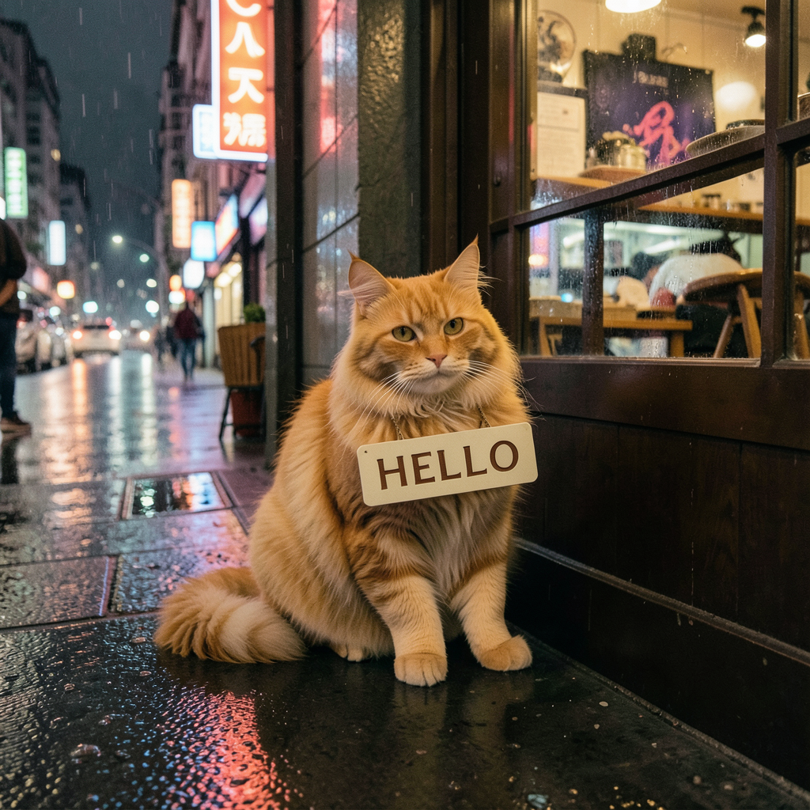

<details>
<summary>Prompt、预期结果与 workflow</summary>

Prompt:

```text
A fluffy orange cat sitting by a cafe doorway on a rainy neon-lit Shanghai street, holding a small cream sign that reads HELLO. Cinematic photograph, warm cafe light, wet pavement reflections, no other writing.
```

预期结果：橘猫、雨夜咖啡馆构图，以及可读的 HELLO。

workflow / api.json：[flux2-1024-attention/api.json](cases/flux2-1024-attention/api.json)

</details>

---

## 文生图：雨夜上海咖啡馆橘猫（768×768）（`qwen-base-t2i-cat-768`）

- 模型：Qwen-Image-2.1
- 来源级别：T｜旧本机试验有 API 与实际输出文件；耗时记录未知
- 执行：历史记录 · 无可用输出图片
- 视觉结论：通过

API 记录为 768 分辨率，输出文件存在且已目视检查；可读记录未提供该次 history 的起止时间，故耗时为 null。

输入图片：
- 此功能没有输入图片。

输出图片：
- 无输出

<details>
<summary>Prompt、预期结果与 workflow</summary>

Prompt:

```text
一只橘猫坐在雨后的上海街头咖啡馆窗边，望着霓虹灯倒影。电影摄影，细腻写实，暖色室内灯光，画面中没有文字。
```

预期结果：生成雨后上海咖啡馆窗边的橘猫图像；此条记录旧版基础 Qwen-Image-2.1 文生图。

workflow / api.json：[旧基线 api.json：qwen-image-2.1-768-api.json](../../qwen-image-2.1-768-api.json)

</details>

---

## 语义图像编辑：橘猫变白猫（512×512；非遮罩局部重绘）（`qwen-base-edit-orange-to-white-cat-512`）

- 模型：Qwen-Image-2.1
- 来源级别：T｜本机 history 成功并有图片复核
- 执行：历史记录 · 无可用输出图片；耗时：423.46 秒
- 视觉结论：通过

history 状态 success；目视检查为白猫，姿态与街景构图基本保留，分辨率和毛发细节有变化。

输入图片：
- 输入 1 · D:/AI/barely-comfy\ComfyUI\input\liuyue-qwen-base-source.png：输入图片未找到

输出图片：
- 无输出

<details>
<summary>Prompt、预期结果与 workflow</summary>

Prompt:

```text
Edit the reference image: turn the orange cat into a fluffy white cat. Keep the cat's pose, the rainy Shanghai street, cafe window, neon reflections, camera framing and lighting the same. Photorealistic. No text.
```

预期结果：橘猫变为白猫，姿态、雨街、咖啡馆窗户、霓虹反射和构图大致保留。

workflow / api.json：[旧基线 api.json：qwen-base-edit-512-api.json](../2026-10-18/qwen-base-edit-512-api.json)

</details>

---

## 文生图：雾林苔石上的狐狸（512×512，4 步）（`kroma-opd-q2-t2i-fox-512`）

- 模型：Kroma v0.3.1 OPD Q2
- 来源级别：T｜本机 history 成功并有图片复核；结果仅对应 OPD Q2_K 文件与本工作流
- 执行：历史记录 · 无可用输出图片；耗时：285.03 秒
- 视觉结论：通过

history 状态 success；目视检查狐狸、苔石和雾林与提示相符，未见黑图或明显噪声。

输入图片：
- 此功能没有输入图片。

输出图片：
- 无输出

<details>
<summary>Prompt、预期结果与 workflow</summary>

Prompt:

```text
A little red fox sitting on a mossy rock in a misty forest, detailed fur, soft morning light, cinematic photography, no text
```

预期结果：生成苔石、雾林与狐狸场景；不外推为多图参考、图生图或换头验证。

workflow / api.json：[旧基线 api.json：kroma-api.json](../2026-10-18/kroma-api.json)

</details>

---

## 文生图：丛林宇航员（512×512，8 步 LoRA 候选）（`moss-sft-dmd-8step-t2i-astronaut-512`）

- 模型：MOSS-Image-5B
- 来源级别：T｜本机 history 成功并有图片复核；作者未公布的完整采样配方未声称复现
- 执行：历史记录 · 无可用输出图片；耗时：187.575 秒
- 视觉结论：通过

history 状态 success；目视检查有完整宇航员和丛林，无黑图或纹理噪声；启用了 gfx1032 INT8 fallback。

输入图片：
- 此功能没有输入图片。

输出图片：
- 无输出

<details>
<summary>Prompt、预期结果与 workflow</summary>

Prompt:

```text
Astronaut walking through a dense jungle, vibrant foliage, shafts of sunlight, detailed cinematic photograph, no text
```

预期结果：生成完整宇航员与丛林阳光场景；本条为第三方 DMD LoRA 的本机 8 步候选验证。

workflow / api.json：[旧基线 api.json：moss8-api.json](../2026-10-18/moss8-api.json)

</details>

---

## 文生图对照：丛林宇航员（512×512，50 步）（`moss-sft-50step-t2i-astronaut-512`）

- 模型：MOSS-Image-5B
- 来源级别：T｜本机 history 成功并有图片复核
- 执行：历史记录 · 无可用输出图片；耗时：198.197 秒
- 视觉结论：通过

history 状态 success；目视检查画面有完整宇航员、丛林与阳光，符合提示；启用了 gfx1032 INT8 fallback。

输入图片：
- 此功能没有输入图片。

输出图片：
- 无输出

<details>
<summary>Prompt、预期结果与 workflow</summary>

Prompt:

```text
Astronaut walking through a dense jungle, vibrant foliage, shafts of sunlight, detailed cinematic photograph, no text
```

预期结果：生成完整宇航员与丛林阳光场景；用于与 8 步 DMD LoRA 候选对照。

workflow / api.json：[旧基线 api.json：moss-api.json](../2026-10-18/moss-api.json)

</details>

---

## 文生图：雨夜咖啡馆白猫（512×512，8 步；普通 Turbo 对照，非 UN）（`qwen-turbo-plain-t2i-white-cat-512`）

- 模型：Qwen 2.1 Turbo（普通对照）
- 来源级别：T｜本机 history 成功并有图片复核；明确不代表 Turbo-UN
- 执行：历史记录 · 无可用输出图片；耗时：652.782 秒
- 视觉结论：通过

history 状态 success；目视检查为完整白猫、雨窗与霓虹街景，未见黑图或噪声图。此记录使用普通 Turbo 和原有编码器，不是 Turbo-UN。

输入图片：
- 此功能没有输入图片。

输出图片：
- 无输出

<details>
<summary>Prompt、预期结果与 workflow</summary>

Prompt:

```text
A fluffy white cat in a rain-soaked Shanghai cafe, looking out at neon reflections. Cinematic photorealism, warm indoor light, no text.
```

预期结果：生成雨夜上海咖啡馆窗边白猫；仅作为标准 Turbo 的输出基线，不作为 UN 编码器结果。

workflow / api.json：[旧基线 api.json：qwen-turbo-api.json](../2026-10-18/qwen-turbo-api.json)

</details>

---

## 角色替换（`minimax-h3-bfs-role-replacement`）

- 模型：MiniMax H3 / BFS
- 来源级别：I｜索引标题明示；A｜作者站外摘要展示参考角色替换样例；W｜公开 BFS/原生节点工作流；T｜本功能未运行；另有独立加载诊断
- 执行：阻塞 · 无输出
- 视觉结论：本功能未验证；加载诊断已通过

独立5帧加载/采样/解码诊断已通过并保存输出，但不是本项功能的验收。本项对应的BFS/长视频/音频工作流尚无实际输出，仍未验证；不能用诊断图补位。
证据：[
  "../../research/liuyue-comfyui-models-2026-10-18.md",
  "../../research/liuyue-five-model-trial-sources.md",
  "../../research/feature-claims-2026-10-19.md",
  "../2026-10-18/README.md",
  "https://bbs.monster/thread-5296-1-1.html",
  "https://huggingface.co/Alissonerdx/Minimax-H3-ComfyUI/blob/main/docs/character-swap.md"
]

输入图片：
- 此功能没有输入图片。

输出图片：
- 无输出

阻塞原因：独立5帧加载/采样/解码诊断已通过并保存输出，但不是本项功能的验收。本项对应的BFS/长视频/音频工作流尚无实际输出，仍未验证；不能用诊断图补位。
证据：[
  "../../research/liuyue-comfyui-models-2026-10-18.md",
  "../../research/liuyue-five-model-trial-sources.md",
  "../../research/feature-claims-2026-10-19.md",
  "../2026-10-18/README.md",
  "https://bbs.monster/thread-5296-1-1.html",
  "https://huggingface.co/Alissonerdx/Minimax-H3-ComfyUI/blob/main/docs/character-swap.md"
]

---

## 长音频驱动／长视频后段劣化改善（`minimax-h3-bfs-long-audio-degradation`）

- 模型：MiniMax H3 / BFS
- 来源级别：I｜索引标题明示；A｜作者站外摘要提及长音频开关、首尾对照及该样例的后段改善；T｜本功能未运行；另有独立加载诊断
- 执行：阻塞 · 无输出
- 视觉结论：本功能未验证；加载诊断已通过

独立5帧加载/采样/解码诊断已通过并保存输出，但不是本项功能的验收。本项对应的BFS/长视频/音频工作流尚无实际输出，仍未验证；不能用诊断图补位。
证据：[
  "../../research/liuyue-comfyui-models-2026-10-18.md",
  "../../research/liuyue-five-model-trial-sources.md",
  "../../research/feature-claims-2026-10-19.md",
  "../2026-10-18/README.md",
  "https://bbs.monster/thread-5296-1-1.html"
]

输入图片：
- 此功能没有输入图片。

输出图片：
- 无输出

阻塞原因：独立5帧加载/采样/解码诊断已通过并保存输出，但不是本项功能的验收。本项对应的BFS/长视频/音频工作流尚无实际输出，仍未验证；不能用诊断图补位。
证据：[
  "../../research/liuyue-comfyui-models-2026-10-18.md",
  "../../research/liuyue-five-model-trial-sources.md",
  "../../research/feature-claims-2026-10-19.md",
  "../2026-10-18/README.md",
  "https://bbs.monster/thread-5296-1-1.html"
]

---

## 一键换头（`minimax-h3-bfs-one-click-head-swap`）

- 模型：MiniMax H3 / BFS
- 来源级别：I｜索引标题明示；当前可读站外摘要未逐项验证该功能；T｜本功能未运行；另有独立加载诊断
- 执行：阻塞 · 无输出
- 视觉结论：本功能未验证；加载诊断已通过

独立5帧加载/采样/解码诊断已通过并保存输出，但不是本项功能的验收。本项对应的BFS/长视频/音频工作流尚无实际输出，仍未验证；不能用诊断图补位。
证据：[
  "../../research/liuyue-comfyui-models-2026-10-18.md",
  "../../research/liuyue-five-model-trial-sources.md",
  "../../research/feature-claims-2026-10-19.md",
  "../2026-10-18/README.md"
]

输入图片：
- 此功能没有输入图片。

输出图片：
- 无输出

阻塞原因：独立5帧加载/采样/解码诊断已通过并保存输出，但不是本项功能的验收。本项对应的BFS/长视频/音频工作流尚无实际输出，仍未验证；不能用诊断图补位。
证据：[
  "../../research/liuyue-comfyui-models-2026-10-18.md",
  "../../research/liuyue-five-model-trial-sources.md",
  "../../research/feature-claims-2026-10-19.md",
  "../2026-10-18/README.md"
]

---

## 视频续写（`minimax-h3-video-continuation`）

- 模型：MiniMax H3 / BFS
- 来源级别：I｜索引标题明示；M｜ComfyUI 官方 H3 文档有分段续写流程，但不证明标题的“一键”主张；T｜本功能未运行；另有独立加载诊断
- 执行：阻塞 · 无输出
- 视觉结论：本功能未验证；加载诊断已通过

独立5帧加载/采样/解码诊断已通过并保存输出，但不是本项功能的验收。本项对应的BFS/长视频/音频工作流尚无实际输出，仍未验证；不能用诊断图补位。
证据：[
  "../../research/liuyue-comfyui-models-2026-10-18.md",
  "../../research/liuyue-five-model-trial-sources.md",
  "../../research/feature-claims-2026-10-19.md",
  "../2026-10-18/README.md",
  "https://docs.comfy.org/tutorials/video/minimax/minimax-h3"
]

输入图片：
- 此功能没有输入图片。

输出图片：
- 无输出

阻塞原因：独立5帧加载/采样/解码诊断已通过并保存输出，但不是本项功能的验收。本项对应的BFS/长视频/音频工作流尚无实际输出，仍未验证；不能用诊断图补位。
证据：[
  "../../research/liuyue-comfyui-models-2026-10-18.md",
  "../../research/liuyue-five-model-trial-sources.md",
  "../../research/feature-claims-2026-10-19.md",
  "../2026-10-18/README.md",
  "https://docs.comfy.org/tutorials/video/minimax/minimax-h3"
]

---

## 一键目标替换（`minimax-h3-one-click-target-replacement`）

- 模型：MiniMax H3 / BFS
- 来源级别：I｜索引标题明示；M｜官方文档有遮罩视频编辑/物件移除相关流程，但不等同于标题的“一键目标替换”；T｜本功能未运行；另有独立加载诊断
- 执行：阻塞 · 无输出
- 视觉结论：本功能未验证；加载诊断已通过

独立5帧加载/采样/解码诊断已通过并保存输出，但不是本项功能的验收。本项对应的BFS/长视频/音频工作流尚无实际输出，仍未验证；不能用诊断图补位。
证据：[
  "../../research/liuyue-comfyui-models-2026-10-18.md",
  "../../research/liuyue-five-model-trial-sources.md",
  "../../research/feature-claims-2026-10-19.md",
  "../2026-10-18/README.md",
  "https://docs.comfy.org/tutorials/video/minimax/minimax-h3"
]

输入图片：
- 此功能没有输入图片。

输出图片：
- 无输出

阻塞原因：独立5帧加载/采样/解码诊断已通过并保存输出，但不是本项功能的验收。本项对应的BFS/长视频/音频工作流尚无实际输出，仍未验证；不能用诊断图补位。
证据：[
  "../../research/liuyue-comfyui-models-2026-10-18.md",
  "../../research/liuyue-five-model-trial-sources.md",
  "../../research/feature-claims-2026-10-19.md",
  "../2026-10-18/README.md",
  "https://docs.comfy.org/tutorials/video/minimax/minimax-h3"
]

---

## 双GGUF文生图／低显存运行（`zimage-gguf-photo`）

- 模型：Z-Image-Turbo GGUF Q4_K_M / Qwen3-4B Q4_K_M
- 来源级别：用户提供离线正文；自编验收提示词；公共可追溯工作流
- 执行：阻塞 · 无输出
- 视觉结论：尚未进行视觉检查
- 运行配置：计划配置，尚未执行：RX6650XT扩散；CPU文本编码/CPU VAE；关闭动态VRAM、lowvram、预留2GB、同步卸载；先512²，无额外LoRA

CPU文本配置耗时过长且整机可用内存低于0.5GB；API中止后装载仍未返回，已结束本任务服务。无输出，不判为模型功能失败。
证据：trials\2026-10-20-zimage\cases\zimage-gguf-photo\operator-stop.json

输入图片：
- 此功能没有输入图片。

输出图片：
- 无输出

阻塞原因：CPU文本配置耗时过长且整机可用内存低于0.5GB；API中止后装载仍未返回，已结束本任务服务。无输出，不判为模型功能失败。
证据：trials\2026-10-20-zimage\cases\zimage-gguf-photo\operator-stop.json
