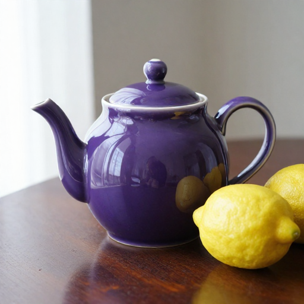

# Z-Image GGUF 连续运行复核 · 2026-10-21

**本轮 3 + 3 + 5，共 11 张出图且目视通过，历史原生崩溃未复现；没有验证任何 GGUF 根因补丁。** 三组各自复用一个进程，组间重启，不能写成同一进程连续 11 张。旧失败证据保留，不能据此宣布长期稳定。

## 本机与固定输入

RX 6650 XT / gfx1032，8GB VRAM，16GB RAM；Windows，Python 3.12.6，torch 2.12.0+rocm7.14.0，ComfyUI 0.41.0。ComfyUI 提交 `ce1e922d8623bb507180e32a0c01a7d0e29edef7`，GGUF 提交 `373048b8403a7820620065210a691263d4da0a61`；本轮均无源码修改。三份实际使用的 G 盘权重已重新计算 SHA-256，与历史清单一致，见 [provenance.json](provenance.json)。没有重新下载模型或安装依赖。

双 Q4_K_M GGUF、512×512、9 步、CFG 1、Euler/simple、shift 3、GPU 文本编码、CPU VAE、关闭动态显存和异步卸载、默认锁页内存。每次改变正提示词的颜色和 seed。保存每次实际提交图和 history，确认文本编码节点 8、采样节点 10 没有被缓存跳过。

## 三组结果

- **不额外预留显存**：[3/3 执行记录](no-reserve/summary.json)，提交后 114.72 / 50.20 / 48.11 秒。首轮扩散模型完整加载。实际查看红、蓝、绿壶，均正常。
- **恢复预留 2GB**：[3/3 执行记录](reserve2/summary.json)，100.64 / 50.14 / 48.16 秒。首轮约 710MB 扩散权重 offload，仍能连续出图。三张与上一组逐像素相同，排除只返回 success 却出不同噪声的情况。
- **历史完整提示词 + 预留 2GB**：[5/5 执行记录](original-prompts/summary.json)，109.98 / 50.23 / 48.12 / 48.12 / 48.11 秒。依次生成红、蓝、绿、黄、紫壶，每张均已实际查看。前两组使用简短提示词；第三组恢复历史完整描述并从原 seed 开始递增。不是把三组当成完全相同的输入对照。

耗时均为提交后到检测到 history 的时间，含该任务模型加载与 CPU VAE，不含服务冷启动；2 秒轮询会引入检测延迟。全部 [目视记录](reviews.json) 和原始/公开 PNG SHA 均保留，公开 PNG 仅清除元数据，逐像素检查一致。



## 可以和不可以得出的结论

1. 当前独占本机 GPU 的测试条件下，GGUF 连续出图能够通过多次文本编码、部分卸载、再次采样。
2. “预留 2GB 必然导致第二张崩溃”的假设不成立；本轮该配置也通过了 3 张和 5 张两组。
3. 历史 [第二张原生崩溃](../2026-10-20-zimage/cases/zimage-gguf-prompt-change/attempts/001-native-access-violation/attempt-summary.json) 仍是有效失败证据。本轮未找到可重复触发条件，不能判断是否与当时内存压力、此前进程状态或具体卸载时序有关。
4. 上游 [#444](https://github.com/city96/ComfyUI-GGUF/issues/444) / [未合并 #445](https://github.com/city96/ComfyUI-GGUF/pull/445) 涉及 `unpatch_model`；本机旧栈位于 `partially_unload`。本轮没有套用该补丁，也没有把进程重启称为根因修复。
5. 没有测试 1024 分辨率、LoRA 强度切换、跨模型反复切换或长期运行；Qwen 重载故障需要自己的回归，不能自动标为解决。

## 重跑

使用已有运行环境中的 Python，需要 Pillow 和 psutil。先确认其他 ComfyUI 没有占用 GPU；工具不会自动停止别的服务。它启动自己的 8190 进程，结束时清理自己的进程树，每次必须指定新的输出目录。

```powershell
D:\MyProject\amd_comfy\.venv\Scripts\python.exe scripts/repro_gguf_repeat.py `
  --runtime D:\MyProject\amd_comfy `
  --workflow trials/2026-10-21-gguf-repeat/workflow.api.json `
  --model-paths D:\MyProject\amd_comfy\trials\2026-10-20-zimage\ssd-model-paths.yaml `
  --out runs/gguf-repeat-new --count 5 `
  --extra-arg=--reserve-vram --extra-arg=2.0
```

工作流要求固定的节点 ID 和包含 `blue ceramic` 的模板提示词；工具不是任意模型的通用批处理器。新版本还会记录约 2 秒间隔的进程树 RSS、整机可用 RAM、进程退出码及 faulthandler 栈，为未来偶发崩溃补充资源上下文。本轮三组在该资源采样功能加入前已经启动，因此没有本轮 RAM 峰值结论。

原始日志、完整 history 和原始 PNG 位于本地 `runs/gguf-repeat-*`，不提交到公开仓库。发布精选副本可用 [导出脚本](../../scripts/export_repeat_evidence.py)，它保留原始文件 SHA、公开副本 SHA、实际工作流和相关日志信号，不发布整段原始日志。

## 排查工具自检

故意传入无效启动参数的负向检查得到退出码 1，报告 `Server died during startup: 2`，`server_stopped=true`，没有被记为出图成功。这只证明工具能识别启动失败，不能当作重现了 GGUF 原生崩溃。

MOSS 防回归改动及其 5 项测试见 [故障追踪](../../docs/06-failure-tracker.md)。
